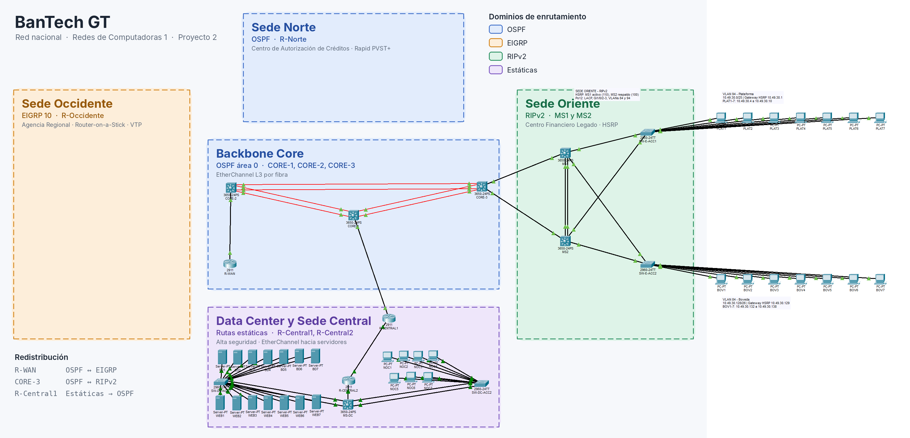
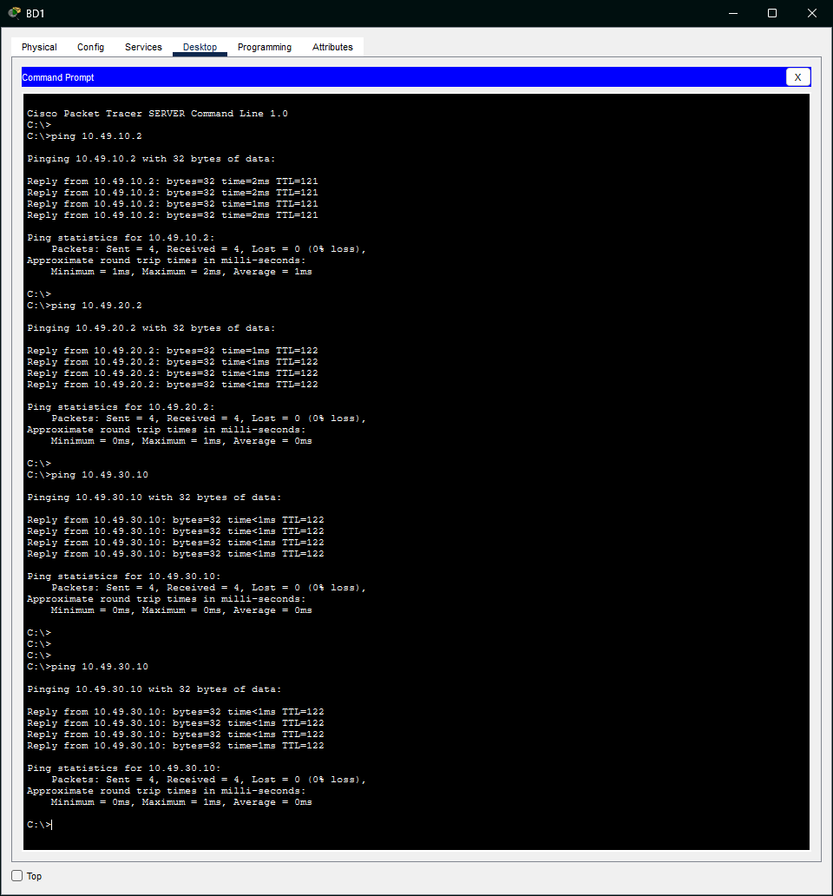
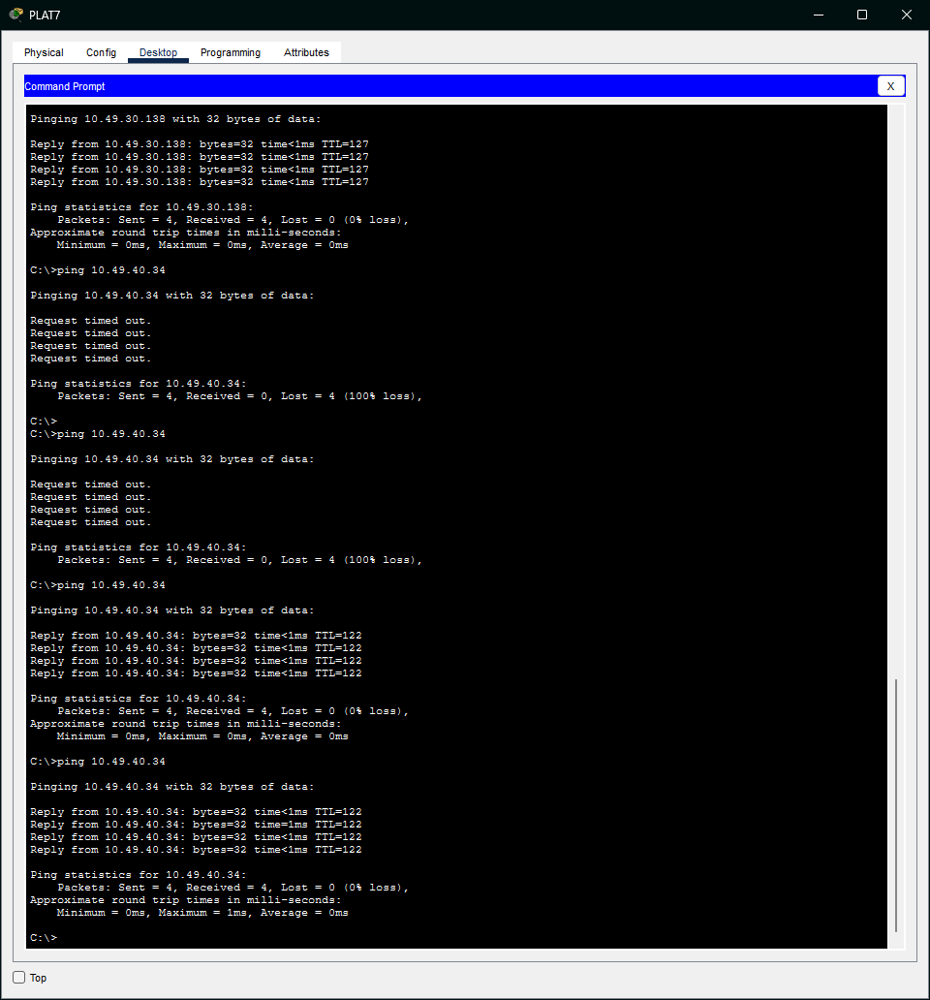
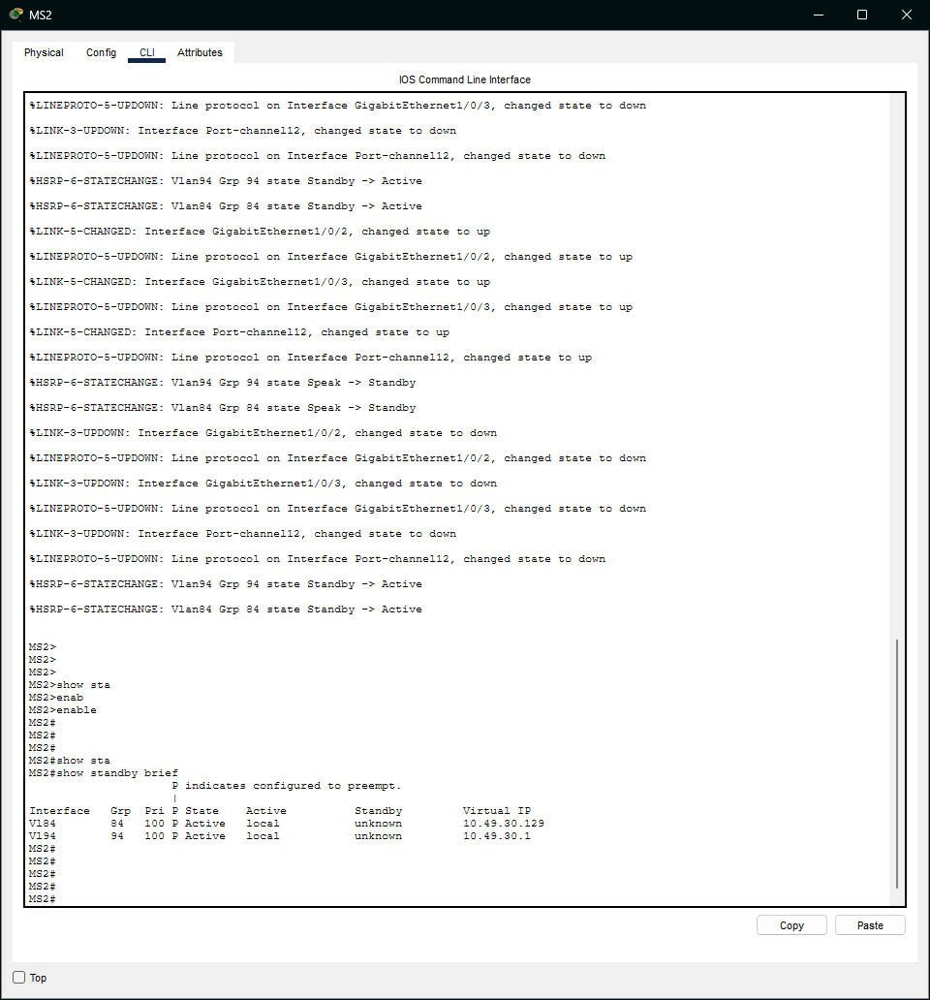
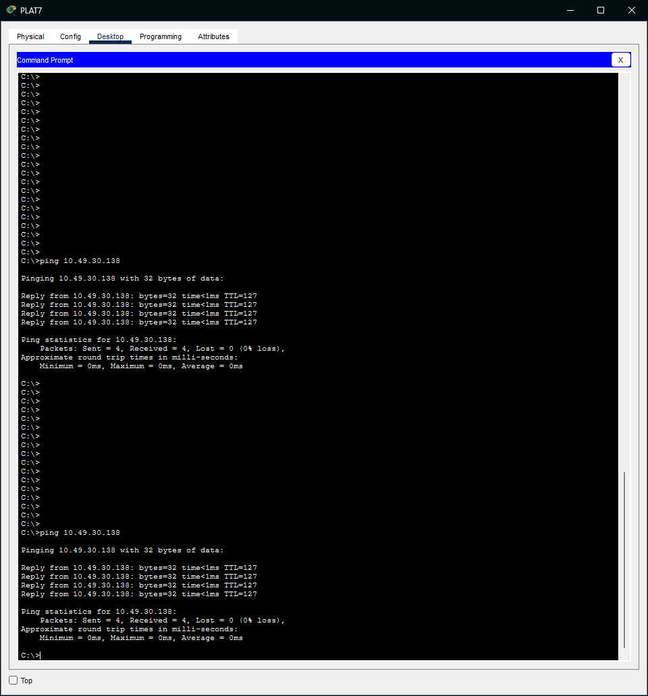

# Sede Oriente — Centro Financiero Legado

Redes de Computadoras 1, Proyecto 2, BanTech GT. Grupo 4.

Responsable: Luis Pablo Carlos Tapia, carné 202203257. Implementación inicial: 20 de octubre de 2026. Evidencias de redundancia y revisión de integración: 22 de octubre de 2026.

El maestro final [Unido/BanTech_GT_v1.pkt](../Unido/BanTech_GT_v1.pkt) reúne todas las sedes. Las copias `.pkt` de esta carpeta son históricas. La [prueba corregida de caída del uplink de MS1](../Unido/Prueba_HSRP_uplink_MS1_caido.pkt) y la [verificación final del 23/10/2026](../Unido/VERIFICACION_FINAL.md) se conservan en `Unido/`. El [manual general](../README.md) consolida el diseño y los resultados actuales.

La sesión revisada en Packet Tracer 9.0.1 contenía 112 dispositivos y 120 enlaces, sin enlaces caídos ni IPs duplicadas, y se identificó como `Unido/BanTech_GT_v1.pkt`. Las verificaciones por consola describen esa sesión; no comparan las copias guardadas de `Luis/` y `Unido/`.

## Arquitectura



La imagen anterior es histórica. La [captura general final](../Unido/Topologia_final.png) muestra las cuatro sedes y el backbone ordenados y delimitados por protocolo. La [topología durante la caída de MS1](Images/09_Topologia_MS1_Apagado.png) corresponde a las pruebas históricas del 22/10.

MS1 y MS2 son switches multicapa 3650-24PS, cada uno con una fuente `AC-POWER-SUPPLY` en la ranura interna `2/4`. Ambos realizan enrutamiento inter-VLAN y se unen mediante un EtherChannel troncal LACP de dos cables (Po12). SW-E-ACC1 y SW-E-ACC2 son 2960-24TT y tienen un enlace troncal hacia cada equipo de distribución. Cada switch de acceso conecta siete PCs.

HSRP mantiene gateways virtuales estables para los hosts. MS1 tiene prioridad 105 y MS2 prioridad 100; ambos usan `preempt` y siguen Gi1/0/1 con decremento 10. Si falla el uplink de MS1, su prioridad baja a 95 y MS2 asume ambos grupos. Rapid PVST+ evita los bucles de capa 2. MS1 tiene prioridad STP 24576 y MS2 28672. Los puertos hacia PCs usan PortFast y BPDU Guard.

Oriente se integra con CORE-3 mediante RIPv2 y dos enlaces ruteados independientes. CORE-3 redistribuye RIP hacia OSPF y conserva un agregado estático de respaldo `10.49.30.0/24`, preferido vía MS2 con distancia 250 y alternativo vía MS1 con distancia 251. El agregado conserva el retorno OSPF durante la falla; las rutas específicas de ambas VLANs siguen aprendidas por RIP. MS1 y MS2 no tienen rutas estáticas. Sus SVIs son pasivas en RIP. Los cuatro switches usan VTP transparente y definen las VLANs localmente.

La redundancia incluye la caída aislada del uplink de cualquiera de los equipos de distribución, además de los caminos físicos alternativos y Po12. CORE-3 sigue siendo el punto común de salida de Oriente; cada PC tiene una única conexión a su switch de acceso.

## VLANs e interfaces

| VLAN | Nombre | Red | Gateway virtual | IP MS1 | IP MS2 |
|---|---|---|---|---|---|
| 84 | Boveda | 10.49.30.128/26 | 10.49.30.129 | 10.49.30.130 | 10.49.30.131 |
| 94 | Plataforma | 10.49.30.0/25 | 10.49.30.1 | 10.49.30.2 | 10.49.30.3 |

| Enlace | Extremo A | Extremo B | Red / VLANs |
|---|---|---|---|
| CORE-3 a MS1 | CORE-3 Gi1/0/1, 10.49.0.33 | MS1 Gi1/0/1, 10.49.0.34 | 10.49.0.32/30 |
| CORE-3 a MS2 | CORE-3 Gi1/0/2, 10.49.0.37 | MS2 Gi1/0/1, 10.49.0.38 | 10.49.0.36/30 |
| Po12, LACP | MS1 Gi1/0/2-3 | MS2 Gi1/0/2-3 | Troncal 84,94 |
| Acceso Plataforma | MS1 Gi1/0/4 | SW-E-ACC1 Gi0/1 | Troncal 84,94 |
| Acceso Plataforma, respaldo | MS2 Gi1/0/4 | SW-E-ACC1 Gi0/2 | Troncal 84,94 |
| Acceso Bóveda | MS1 Gi1/0/5 | SW-E-ACC2 Gi0/1 | Troncal 84,94 |
| Acceso Bóveda, respaldo | MS2 Gi1/0/5 | SW-E-ACC2 Gi0/2 | Troncal 84,94 |

Todos los enlaces nuevos usan cobre directo; los equipos negociaron los enlaces correctamente en Packet Tracer. Cada PC usa el puerto Fa0/1 a Fa0/7 de su switch según su número.

## Equipos finales

| Equipo | Switch / puerto | VLAN | IP | Máscara | Gateway |
|---|---|---|---|---|---|
| PLAT1 | SW-E-ACC1 Fa0/1 | 94 | 10.49.30.4 | 255.255.255.128 | 10.49.30.1 |
| PLAT2 | SW-E-ACC1 Fa0/2 | 94 | 10.49.30.5 | 255.255.255.128 | 10.49.30.1 |
| PLAT3 | SW-E-ACC1 Fa0/3 | 94 | 10.49.30.6 | 255.255.255.128 | 10.49.30.1 |
| PLAT4 | SW-E-ACC1 Fa0/4 | 94 | 10.49.30.7 | 255.255.255.128 | 10.49.30.1 |
| PLAT5 | SW-E-ACC1 Fa0/5 | 94 | 10.49.30.8 | 255.255.255.128 | 10.49.30.1 |
| PLAT6 | SW-E-ACC1 Fa0/6 | 94 | 10.49.30.9 | 255.255.255.128 | 10.49.30.1 |
| PLAT7 | SW-E-ACC1 Fa0/7 | 94 | 10.49.30.10 | 255.255.255.128 | 10.49.30.1 |
| BOV1 | SW-E-ACC2 Fa0/1 | 84 | 10.49.30.132 | 255.255.255.192 | 10.49.30.129 |
| BOV2 | SW-E-ACC2 Fa0/2 | 84 | 10.49.30.133 | 255.255.255.192 | 10.49.30.129 |
| BOV3 | SW-E-ACC2 Fa0/3 | 84 | 10.49.30.134 | 255.255.255.192 | 10.49.30.129 |
| BOV4 | SW-E-ACC2 Fa0/4 | 84 | 10.49.30.135 | 255.255.255.192 | 10.49.30.129 |
| BOV5 | SW-E-ACC2 Fa0/5 | 84 | 10.49.30.136 | 255.255.255.192 | 10.49.30.129 |
| BOV6 | SW-E-ACC2 Fa0/6 | 84 | 10.49.30.137 | 255.255.255.192 | 10.49.30.129 |
| BOV7 | SW-E-ACC2 Fa0/7 | 84 | 10.49.30.138 | 255.255.255.192 | 10.49.30.129 |

Las subredes conservan capacidad para los 60 hosts de Plataforma y 40 de Bóveda del plan; se simulan siete PCs por VLAN.

## Configuraciones

- [MS1.conf](Config/MS1.conf)
- [MS2.conf](Config/MS2.conf)
- [SW-E-ACC1.conf](Config/SW-E-ACC1.conf)
- [SW-E-ACC2.conf](Config/SW-E-ACC2.conf)
- [Guía de aplicación y verificación](Config/README.md)

Son comandos de configuración para pegar en la CLI IOS. Durante la automatización, `configureIosDevice` no aplicó correctamente los rangos de interfaces; se resolvió configurando cada interfaz individualmente y verificando por consola. En Po12 deben coincidir las VLANs permitidas del Port-channel y sus miembros antes de agruparlos.

## Verificaciones reales

### Corrección final: caída aislada del uplink, 23/10/2026

Con Gi1/0/1 de MS1 en `shutdown`, MS1 quedó Standby con prioridad 95 y MS2 Active con prioridad 100. PLAT1 → BD1, BOV1 → BD1 y BD1 → PLAT1 terminaron con 4/4 respuestas después de converger. Se restauró solamente el uplink: MS1 volvió a Active con prioridad 105 sin reiniciar puertos de acceso. También se verificó el uplink de MS2 caído: prioridad 90, agregado de CORE-3 vía MS1 con distancia 251 y pings 4/4 desde ambas VLANs hacia BD1.

El [registro de verificación final](../Unido/VERIFICACION_FINAL.md) contiene extractos reales y los comandos para reproducir la prueba. Los apartados siguientes conservan las evidencias históricas del 22/10; no describen la configuración HSRP actual.

### Estado estable

`show standby brief` mostró MS1 Active y MS2 Standby en los grupos 84 y 94, con las IPs virtuales 10.49.30.129 y 10.49.30.1. MS1 reconoció como standby 10.49.30.131 y 10.49.30.3 respectivamente.

`show etherchannel summary` mostró en ambos equipos:

```text
12     Po12(SU)           LACP   Gig1/0/2(P) Gig1/0/3(P)
```

`show ip route rip` en CORE-3 mostró ambas redes por los dos equipos:

```text
R 10.49.30.0/25 [120/1] via 10.49.0.34, GigabitEthernet1/0/1
               [120/1] via 10.49.0.38, GigabitEthernet1/0/2
R 10.49.30.128/26 [120/1] via 10.49.0.34, GigabitEthernet1/0/1
                 [120/1] via 10.49.0.38, GigabitEthernet1/0/2
```

| Origen | Destino | Resultado final |
|---|---|---|
| PLAT7 | BOV7, 10.49.30.138 | 4 enviados, 4 recibidos |
| PLAT1 | BD1, 10.49.40.34 | 4 enviados, 4 recibidos |
| BOV1 | WEB1, 10.49.40.2 | 4 enviados, 4 recibidos |
| BD1 | PLAT1, 10.49.30.4 | 4 enviados, 4 recibidos tras recuperar MS1 |

Algunos primeros pings tuvieron pérdidas durante el establecimiento inicial; las repeticiones indicadas terminaron con 0% de pérdida.

### Falla completa de MS1

Se apagó MS1 y se consultó `show standby brief` en MS2. Ambos grupos pasaron a Active local. Durante la reconvergencia se observaron pings con 100% y luego 25% de pérdida. Después de converger:

- BOV7 → BD1: 4/4 respuestas con MS1 apagado.
- PLAT1 → BOV1: 4/4 respuestas con MS1 apagado.

Se encendió MS1, se verificó su retorno a Active mediante `preempt` y el retorno de MS2 a Standby. La recuperación también tuvo pérdidas transitorias; no se afirma conmutación sin pérdida ni se midió un tiempo exacto de recuperación. La secuencia de evidencias incluye recuperación tras reinicio de puertos, por lo que no demuestra retorno automático sin intervención en todos los casos.

### Falla de un miembro de Po12

Se aplicó `shutdown` a Gi1/0/2 de MS1. Po12 permaneció `SU`, con Gi1/0/2(D) y Gi1/0/3(P). PLAT7 → BOV7 tuvo inicialmente 2/4 respuestas y después 4/4. Se restauró la interfaz con `no shutdown`.

Estas pruebas históricas corresponden al apagado completo y a un miembro del canal, antes de añadir seguimiento HSRP. La prueba actual de uplink y su recuperación automática se documentan arriba y sustituyen esa limitación del diseño anterior.

## Conectividad del proyecto integrado

| Origen | Destino | Resultado | Evidencia |
|---|---|---|---|
| PC0, Occidente | BD1, 10.49.40.34 | 4/4, 0% pérdida | Consola de la sesión integrada revisada |
| PC-A1, Norte | PLAT1, 10.49.30.4 | 4/4, 0% pérdida | Consola de la sesión integrada revisada |
| PC0, Occidente | PC-A1, 10.49.20.2 | 4/4, 0% pérdida | Consola de la sesión integrada revisada |
| PLAT1, Oriente | BD1, 10.49.40.34 | 4/4, 0% pérdida | Consola de la sesión integrada revisada |
| BD1, Data Center | PC0, 10.49.10.2 | 4/4, 0% pérdida | [Captura](Images/BD1_Ping_PLAT7_Retorno.png) |
| BD1, Data Center | PC-A1, 10.49.20.2 | 4/4, 0% pérdida | [Captura](Images/BD1_Ping_PLAT7_Retorno.png) |
| BD1, Data Center | PLAT7, 10.49.30.10 | 4/4, 0% pérdida | [Captura](Images/BD1_Ping_PLAT7_Retorno.png) |
| PLAT7, Oriente | BD1, 10.49.40.34 | Dos intentos 0/4, luego dos intentos 4/4 | [Captura](Images/PLAT7_Ping_BD1_Recuperado.png) |





La matriz registra pruebas representativas, no todas las combinaciones de hosts o VLANs. Las filas de consola no tienen una captura asociada conservada en esta carpeta.

## Evidencias de redundancia

Las capturas históricas están en `Luis/Images/`. La captura general y los resultados de la corrección final están en `Unido/`.

| Etapa | Capturas |
|---|---|
| Estado inicial de HSRP y EtherChannel | [MS1](Images/01_MS1_Estado_Inicial.png), [MS2](Images/02_MS2_Estado_Inicial.png) |
| STP inicial de acceso | [ACC1](Images/03_ACC1_STP_Inicial.png), [ACC2](Images/04_ACC2_STP_Inicial.png) |
| Falla de un miembro de Po12 | [Canal degradado](Images/05_Po12_Un_Miembro_Apagado.png), [pings](Images/06_Pings_Con_Un_Miembro_Po12.png), [restauración](Images/07_Po12_Restaurado.png) |
| Falla completa de MS1 | [MS2 Active](Images/08_MS2_Active_Con_MS1_Apagado.png), [topología](Images/09_Topologia_MS1_Apagado.png), [pings](Images/10_Pings_Con_MS1_Apagado.png) |
| Acceso por MS2 | [ACC1](Images/11_ACC1_Camino_Hacia_MS2.png), [ACC2](Images/12_ACC2_Camino_Hacia_MS2.png) |
| Retorno de roles HSRP | [MS1 Active](Images/13_MS1_Active_Tras_Recuperacion.png), [MS2 Standby](Images/14_MS2_Standby_Tras_Recuperacion.png) |
| STP tras retorno | [ACC1](Images/15_ACC1_STP_Tras_Retorno_MS1.png), [ACC2](Images/16_ACC2_STP_Tras_Retorno_MS1.png) |
| Conectividad tras retorno | [Pings a interfaces y gateway](Images/17_Pings_Tras_Retorno_MS1.png), [recuperación inter-VLAN tras reinicio de puertos](Images/18_Recuperacion_Tras_Reinicio_Puertos.png) |




