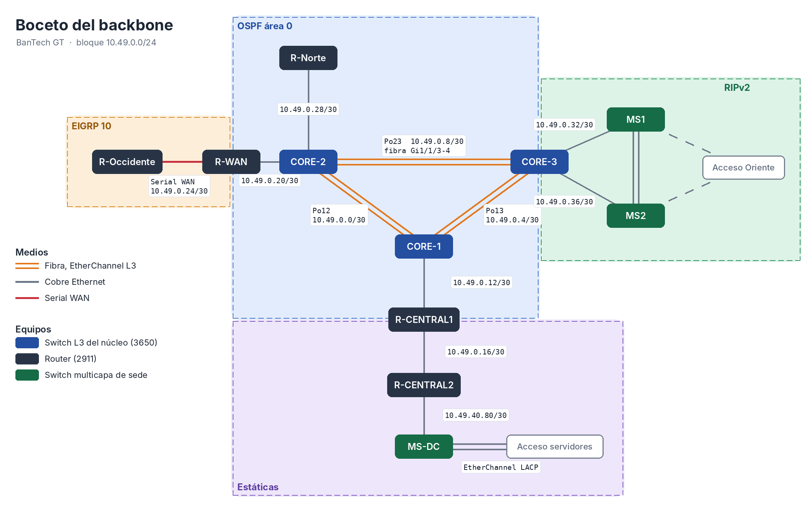

# Manual Técnico, Infraestructura Financiera BanTech GT

Redes de Computadoras 1, Proyecto 2, segundo semestre 2026. Universidad de San Carlos de Guatemala, Facultad de Ingeniería, Escuela de Ciencias y Sistemas.

<!-- Integración del documento: Luis. Cada integrante escribe su sección en sedes/<su carpeta>/seccion.md y Luis la consolida aquí. -->

## 1. Integrantes

| Nombre | Carné | Rol en el proyecto |
|---|---|---|
| Mariano Roberto Rac Noguera | 202101149 | Coordinador, backbone, Data Center y Sede Central |
| Oscar | <!-- carné --> | Sede Occidente y Sede Norte |
| Luis | <!-- carné --> | Sede Oriente, integración de la simulación y del manual |

## 2. Parámetros de identificación

El enunciado liga los parámetros de red al carné del coordinador y al número de grupo. El coordinador es Mariano (carné 202101149), por lo que XX = 49. El mismo valor se usa como segundo octeto de todo el direccionamiento, de modo que cada dirección del proyecto queda amarrada a la regla de identificación.

| Parámetro | Valor | Uso |
|---|---|---|
| XX | 49 | Dominio VTP `bantech49` y segundo octeto de la red `10.49.0.0/16` |
| Y | 4 | Grupo 4. Forma los IDs de VLAN (1Y, 2Y, 1Y+1, etc.) |
| Contraseña VTP | cisco | Sede Occidente |

Los IDs de VLAN se forman concatenando el número con Y. Con Y = 4, la VLAN 1Y es la 14 y la VLAN 1Y+1 es la 15.

## 3. Topología general


<!-- Pendiente (Luis): captura del .pkt maestro con el fondo img/fondos/fondo_general.png, donde se identifica el área de cada protocolo de enrutamiento. -->

La red se divide en un backbone nacional y cuatro redes de borde. El backbone es un núcleo de tres switches de capa 3 que corre OSPF y sirve de punto de encuentro de todos los dominios de enrutamiento. Cada sede se conecta al núcleo por medio de su propio equipo de borde, y cada una pertenece a uno de los cuatro métodos de enrutamiento exigidos.

| Sede | Dominio de enrutamiento | Equipo de borde | Se conecta a |
|---|---|---|---|
| Occidente | EIGRP 10 | R-Occidente | R-WAN (serial) |
| Norte | OSPF área 0 | R-Norte | CORE-2 |
| Oriente | RIPv2 | MS1 y MS2 | CORE-3 |
| Data Center y Central | Rutas estáticas | R-CENTRAL2 | R-CENTRAL1, que se conecta a CORE-1 |

## 4. Backbone Core

<!-- Responsable: Mariano -->

El detalle completo del backbone, del Data Center y de la Sede Central (tablas completas, extractos de todos los equipos y verificaciones) está en [Mariano/README.md](Mariano/README.md). Esta sección resume lo que afecta a todo el grupo.



### 4.1 Justificación del diseño

El núcleo está formado por tres switches multicapa Cisco 3650 conectados en triángulo. El triángulo es la forma mínima en la que cualquier enlace o cualquier equipo del núcleo puede fallar sin partir la red, porque entre dos switches siempre queda un camino alterno a través del tercero. Cada lado del triángulo es un EtherChannel de capa 3 de dos enlaces de fibra negociado con LACP. Así el canal principal de tráfico transaccional suma el ancho de banda de dos enlaces y sobrevive a la caída de uno de ellos sin reconvergencia del protocolo de enrutamiento.

Se eligió EtherChannel de capa 3 (puertos ruteados, sin `switchport`) en lugar de troncales con SVIs porque en un núcleo enrutado cada enlace queda como una red punto a punto independiente. Eso elimina Spanning Tree del núcleo, hace que la redundancia la resuelva OSPF por costo y deja un direccionamiento /30 limpio por enlace.

OSPF es el protocolo del núcleo porque es un estándar abierto, converge rápido y escala por áreas si el banco sigue creciendo. Los otros dominios se colocaron según el papel de cada sede en el negocio. Occidente usa EIGRP porque representa la expansión regional y llega al núcleo por un enlace serial WAN, que es donde EIGRP aprovecha mejor su métrica basada en ancho de banda y retardo. Oriente usa RIPv2 porque es la red del banco recién adquirido, y RIPv2 representa la red legada que se integra sin rediseñarla. Norte habla OSPF directamente con el núcleo porque el centro de autorización de créditos es crítico y conviene que no dependa de ningún punto de redistribución. El Data Center queda en un segmento de rutas estáticas por la política de aislamiento del enunciado.

La redistribución se concentra en un solo equipo por cada par de dominios. Tener un único punto entre dos protocolos evita bucles de redistribución y vuelve predecible el camino de cada ruta. Por esa misma razón MS1 y MS2 suben ambos a CORE-3, que es el único equipo que traduce entre OSPF y RIPv2.

### 4.2 Equipos del backbone

| Equipo | Modelo | Función | Protocolos | Router ID |
|---|---|---|---|---|
| CORE-1 | 3650-24PS | Núcleo, enlace hacia Sede Central | OSPF | 1.1.1.1 |
| CORE-2 | 3650-24PS | Núcleo, agrega WAN y Norte | OSPF | 2.2.2.2 |
| CORE-3 | 3650-24PS | Núcleo y punto de redistribución hacia la red legada | OSPF y RIPv2 | 3.3.3.3 |
| R-WAN | 2911 con HWIC-2T | Borde WAN y punto de redistribución hacia la expansión regional | OSPF y EIGRP 10 | 4.4.4.4 |
| R-CENTRAL1 | 2911 | Punto de redistribución del segmento estático | OSPF y estáticas | 5.5.5.5 |
| R-CENTRAL2 | 2911 | Router de acceso del Data Center | Estáticas | |

### 4.3 Medios físicos y cableado

| Medio | Dónde se usa | Motivo |
|---|---|---|
| Fibra óptica | Los tres EtherChannel del núcleo (módulos GLC-LH-SMD en Gi1/1/1 a Gi1/1/4) | Mayor ancho de banda y distancia en el canal transaccional |
| Ethernet de cobre | Enlaces del núcleo hacia los equipos de borde | Interconexión local dentro del mismo sitio |
| Serial | R-WAN hacia R-Occidente | Representa la conexión WAN hacia la región |

Los cuatro 3650 (CORE-1, CORE-2, CORE-3 y MS-DC) necesitan el módulo AC-POWER-SUPPLY para encender. R-WAN y R-Occidente llevan un módulo HWIC-2T para el enlace serial. En R-WAN el HWIC-2T está en la ranura 3, por eso su puerto serial es Se0/3/0.

| Equipo A | Puerto A | Equipo B | Puerto B | Cable | Agrupación |
|---|---|---|---|---|---|
| CORE-1 | Gi1/1/1 | CORE-2 | Gi1/1/1 | Fibra | Po12 |
| CORE-1 | Gi1/1/2 | CORE-2 | Gi1/1/2 | Fibra | Po12 |
| CORE-1 | Gi1/1/3 | CORE-3 | Gi1/1/1 | Fibra | Po13 |
| CORE-1 | Gi1/1/4 | CORE-3 | Gi1/1/2 | Fibra | Po13 |
| CORE-2 | Gi1/1/3 | CORE-3 | Gi1/1/3 | Fibra | Po23 |
| CORE-2 | Gi1/1/4 | CORE-3 | Gi1/1/4 | Fibra | Po23 |
| CORE-1 | Gi1/0/1 | R-CENTRAL1 | Gi0/0 | Cobre directo | |
| CORE-2 | Gi1/0/1 | R-WAN | Gi0/0 | Cobre directo | |
| CORE-2 | Gi1/0/2 | R-Norte | Gi0/0 | Cobre directo | Se cablea en la fusión |
| CORE-3 | Gi1/0/1 | MS1 | Gi1/0/1 | Cobre directo | Se cablea en la fusión |
| CORE-3 | Gi1/0/2 | MS2 | Gi1/0/1 | Cobre directo | Se cablea en la fusión |
| R-WAN | Se0/3/0 (DCE) | R-Occidente | Serial (según su módulo) | Serial DCE | Se cablea en la fusión |

### 4.4 Tabla de direcciones del backbone

Todo el backbone usa el bloque `10.49.0.0/24` dividido en subredes /30, una por enlace punto a punto. Se ocupan las primeras diez subredes y el resto queda libre para crecimiento.

| # | Enlace | Medio | Red | Extremo A | IP A | Extremo B | IP B |
|---|---|---|---|---|---|---|---|
| 1 | Po12 | Fibra, EtherChannel | 10.49.0.0/30 | CORE-1 Gi1/1/1-2 | 10.49.0.1 | CORE-2 Gi1/1/1-2 | 10.49.0.2 |
| 2 | Po13 | Fibra, EtherChannel | 10.49.0.4/30 | CORE-1 Gi1/1/3-4 | 10.49.0.5 | CORE-3 Gi1/1/1-2 | 10.49.0.6 |
| 3 | Po23 | Fibra, EtherChannel | 10.49.0.8/30 | CORE-2 Gi1/1/3-4 | 10.49.0.9 | CORE-3 Gi1/1/3-4 | 10.49.0.10 |
| 4 | CORE-1 a R-CENTRAL1 | Cobre | 10.49.0.12/30 | CORE-1 Gi1/0/1 | 10.49.0.13 | R-CENTRAL1 Gi0/0 | 10.49.0.14 |
| 5 | R-CENTRAL1 a R-CENTRAL2 | Cobre | 10.49.0.16/30 | R-CENTRAL1 Gi0/1 | 10.49.0.17 | R-CENTRAL2 Gi0/0 | 10.49.0.18 |
| 6 | CORE-2 a R-WAN | Cobre | 10.49.0.20/30 | CORE-2 Gi1/0/1 | 10.49.0.21 | R-WAN Gi0/0 | 10.49.0.22 |
| 7 | R-WAN a R-Occidente | Serial | 10.49.0.24/30 | R-WAN Se0/3/0 (DCE) | 10.49.0.25 | R-Occidente serial (según su módulo) | 10.49.0.26 |
| 8 | CORE-2 a R-Norte | Cobre | 10.49.0.28/30 | CORE-2 Gi1/0/2 | 10.49.0.29 | R-Norte Gi0/0 | 10.49.0.30 |
| 9 | CORE-3 a MS1 | Cobre | 10.49.0.32/30 | CORE-3 Gi1/0/1 | 10.49.0.33 | MS1 Gi1/0/1 | 10.49.0.34 |
| 10 | CORE-3 a MS2 | Cobre | 10.49.0.36/30 | CORE-3 Gi1/0/2 | 10.49.0.37 | MS2 Gi1/0/1 | 10.49.0.38 |

Las interfaces de los switches del núcleo hacia los equipos de borde se configuran como puertos ruteados (`no switchport`). En el enlace serial, R-WAN es el extremo DCE y lleva el `clock rate`.

### 4.5 Puntos de redistribución

| Equipo | Dominios | Qué propaga |
|---|---|---|
| R-WAN | OSPF y EIGRP 10 | Redistribución mutua. Occidente aprende el resto de la red y el núcleo aprende las redes de Occidente |
| CORE-3 | OSPF y RIPv2 | Redistribución mutua. Oriente aprende el resto de la red y el núcleo aprende las redes de Oriente |
| R-CENTRAL1 | Estáticas hacia OSPF | Propaga la ruta estática del Data Center al núcleo sin exponer el segmento estático |

Cada protocolo necesita un dato distinto al recibir rutas externas. OSPF requiere la palabra `subnets` para redistribuir redes con máscara distinta a la de su clase, y como todas las redes del proyecto son subredes de 10.0.0.0/8, sin ella no se redistribuiría ninguna. EIGRP y RIP requieren una métrica explícita, porque no saben traducir el costo de OSPF y sin ella anuncian las rutas como inalcanzables. En EIGRP, `1544 2000 255 1 1500` son ancho de banda en kbps (el de un T1), retardo en decenas de microsegundos, confiabilidad, carga y MTU. En RIP, `metric 2` asigna dos saltos y deja margen bajo el límite de 15.

```
! R-WAN
interface Serial0/3/0
 ip address 10.49.0.25 255.255.255.252
 clock rate 64000
router ospf 1
 router-id 4.4.4.4
 network 10.49.0.20 0.0.0.3 area 0
 redistribute eigrp 10 subnets
router eigrp 10
 network 10.49.0.24 0.0.0.3
 no auto-summary
 redistribute ospf 1 metric 1544 2000 255 1 1500
!
! CORE-3
router ospf 1
 router-id 3.3.3.3
 network 10.49.0.4 0.0.0.3 area 0
 network 10.49.0.8 0.0.0.3 area 0
 redistribute rip subnets
router rip
 version 2
 no auto-summary
 network 10.0.0.0
 passive-interface Port-channel13
 passive-interface Port-channel23
 redistribute ospf 1 metric 2
!
! R-CENTRAL1
ip route 10.49.40.0 255.255.255.0 10.49.0.18
router ospf 1
 router-id 5.5.5.5
 network 10.49.0.12 0.0.0.3 area 0
 network 10.49.0.16 0.0.0.3 area 0
 passive-interface GigabitEthernet0/1
 redistribute static subnets
```

En R-CENTRAL1, `passive-interface GigabitEthernet0/1` anuncia el enlace hacia R-CENTRAL2 en OSPF pero no envía hellos por él, de modo que ningún protocolo dinámico entra al segmento de alta seguridad.

### 4.6 Vecinos OSPF y tabla de enrutamiento del núcleo


En CORE-1 los tres vecinos OSPF (2.2.2.2, 3.3.3.3 y 5.5.5.5) están en FULL. La red 10.49.0.8/30 aparece por dos caminos de costo igual (vía CORE-2 y vía CORE-3), y la ruta `O E2 10.49.40.0 [110/20]` aprendida de R-CENTRAL1 prueba que la ruta estática del Data Center se redistribuye hacia OSPF.

### 4.7 Enlaces de integración entre el backbone y las sedes

Cuatro enlaces unen el backbone con los equipos de borde de Occidente, Norte y Oriente. Cada integrante configura su extremo en su propio archivo, y los cables se conectan al fusionar las partes en `BanTech_GT.pkt`. Al conectarlos, cada enlace debe levantar sin cambios adicionales.

| Enlace | Extremo backbone (Mariano) | Extremo de la sede | Responsable de la sede | Red | Protocolo en ambos extremos |
|---|---|---|---|---|---|
| CORE-2 a R-Norte | CORE-2 Gi1/0/2, 10.49.0.29 | R-Norte Gi0/0, 10.49.0.30 | Oscar | 10.49.0.28/30 | OSPF 1, área 0 |
| R-WAN a R-Occidente | R-WAN Se0/3/0 (DCE, clock rate 64000), 10.49.0.25 | R-Occidente serial según su módulo (DTE), 10.49.0.26 | Oscar | 10.49.0.24/30 | EIGRP 10 |
| CORE-3 a MS1 | CORE-3 Gi1/0/1, 10.49.0.33 | MS1 Gi1/0/1 (puerto ruteado), 10.49.0.34 | Luis | 10.49.0.32/30 | RIPv2, sin auto-summary |
| CORE-3 a MS2 | CORE-3 Gi1/0/2, 10.49.0.37 | MS2 Gi1/0/1 (puerto ruteado), 10.49.0.38 | Luis | 10.49.0.36/30 | RIPv2, sin auto-summary |

Mientras los cables no estén conectados, estas interfaces aparecen como `down` en cada archivo parcial. Ese estado es esperado y no indica un error de configuración.

<!-- Para Oscar: R-Occidente necesita el módulo HWIC-2T (apaga el router antes de insertarlo). R-Norte anuncia sus redes y el enlace 10.49.0.28/30 en OSPF 1 área 0. R-Occidente anuncia sus redes y el enlace 10.49.0.24/30 en EIGRP 10. -->
<!-- Para Luis: MS1 y MS2 llevan ip routing, el puerto Gi1/0/1 con no switchport, y anuncian sus redes y su enlace en RIPv2 con no auto-summary. -->

## 5. Plan de direccionamiento

### 5.1 Bloques por sede

Cada sede tiene reservado un /24 dentro de `10.49.0.0/16`, de modo que cada responsable hace su VLSM sin chocar con los demás.

| Bloque | Uso |
|---|---|
| 10.49.0.0/24 | Enlaces punto a punto del backbone |
| 10.49.10.0/24 | Sede Occidente |
| 10.49.20.0/24 | Sede Norte |
| 10.49.30.0/24 | Sede Oriente |
| 10.49.40.0/24 | Data Center y Sede Central |

### 5.2 Subneteo VLSM

En cada subred se reserva una dirección para el gateway además de los hosts requeridos. En Oriente se reservan tres, porque HSRP usa la IP virtual más una IP real en MS1 y otra en MS2. Por eso Asesores (30 hosts), Legal y Core_BD (14 hosts) y Plataforma (60 hosts) suben a la siguiente máscara.

| Sede | VLAN | Hosts requeridos | Red | Máscara | Gateway | Rango asignable | Broadcast |
|---|---|---|---|---|---|---|---|
| Occidente | Cajas | 45 | 10.49.10.0 | /26 | 10.49.10.1 | .2 a .62 | 10.49.10.63 |
| Occidente | Asesores | 30 | 10.49.10.64 | /26 | 10.49.10.65 | .66 a .126 | 10.49.10.127 |
| Occidente | Seguridad | 12 | 10.49.10.128 | /28 | 10.49.10.129 | .130 a .142 | 10.49.10.143 |
| Occidente | Gerencia | 10 | 10.49.10.144 | /28 | 10.49.10.145 | .146 a .158 | 10.49.10.159 |
| Norte | Análisis | 50 | 10.49.20.0 | /26 | 10.49.20.1 | .2 a .62 | 10.49.20.63 |
| Norte | Auditoría | 25 | 10.49.20.64 | /27 | 10.49.20.65 | .66 a .94 | 10.49.20.95 |
| Norte | Legal | 14 | 10.49.20.96 | /27 | 10.49.20.97 | .98 a .126 | 10.49.20.127 |
| Oriente | Plataforma | 60 | 10.49.30.0 | /25 | 10.49.30.1 (virtual) | .4 a .126 | 10.49.30.127 |
| Oriente | Bóveda | 40 | 10.49.30.128 | /26 | 10.49.30.129 (virtual) | .132 a .190 | 10.49.30.191 |
| Central | Web_Apps | 28 | 10.49.40.0 | /27 | 10.49.40.1 | .2 a .30 | 10.49.40.31 |
| Central | Core_BD | 14 | 10.49.40.32 | /27 | 10.49.40.33 | .34 a .62 | 10.49.40.63 |
| Central | NOC | 10 | 10.49.40.64 | /28 | 10.49.40.65 | .66 a .78 | 10.49.40.79 |
| Central | Enlace R-CENTRAL2 a MS-DC | 2 | 10.49.40.80 | /30 | | .81 y .82 | 10.49.40.83 |

En Oriente, MS1 usa .2 y MS2 usa .3 en Plataforma, y MS1 usa .130 y MS2 usa .131 en Bóveda.

<!-- Oscar y Luis: esta tabla es una propuesta. Si cambian algo en su sede, avísenle a Luis para mantenerla igual al .pkt. -->

## 6. Tabla de VLANs

Los IDs se forman con Y = 4. Los nombres van sin tilde para evitar problemas en IOS.

| ID | Fórmula | Nombre | Sede | Red |
|---|---|---|---|---|
| 14 | 1Y | Cajas | Occidente | 10.49.10.0/26 |
| 24 | 2Y | Asesores | Occidente | 10.49.10.64/26 |
| 34 | 3Y | Gerencia | Occidente | 10.49.10.144/28 |
| 44 | 4Y | Seguridad | Occidente | 10.49.10.128/28 |
| 54 | 5Y | Analisis | Norte | 10.49.20.0/26 |
| 64 | 6Y | Auditoria | Norte | 10.49.20.64/27 |
| 74 | 7Y | Legal | Norte | 10.49.20.96/27 |
| 84 | 8Y | Boveda | Oriente | 10.49.30.128/26 |
| 94 | 9Y | Plataforma | Oriente | 10.49.30.0/25 |
| 15 | 1Y+1 | Core_BD | Central | 10.49.40.32/27 |
| 25 | 2Y+1 | Web_Apps | Central | 10.49.40.0/27 |
| 35 | 3Y+1 | NOC | Central | 10.49.40.64/28 |

## 7. Sede Occidente, Agencia Regional Comercial

<!-- Responsable: Oscar -->


### 7.1 Justificación de la arquitectura

<!-- Pendiente (Oscar): un párrafo que explique por qué se eligió esta topología física, qué ventajas de tolerancia a fallos ofrece y cómo responde a la necesidad de que un problema en Asesores no afecte a Cajas. -->

### 7.2 Mapeo lógico

| Equipo | Función | Enlaces troncales 802.1Q | Puertos de acceso |
|---|---|---|---|
| R-Occidente | Router de borde, inter-VLAN por Router-on-a-Stick | | |
| <!-- switch --> | Switch principal, VTP servidor | | |
| <!-- switch --> | Acceso, VTP cliente | | |

### 7.3 Extractos de configuración

<!-- Pendiente (Oscar): subinterfaces de R-Occidente, VTP, VLANs con nombre y EIGRP. -->

## 8. Sede Norte, Centro de Autorización de Créditos

<!-- Responsable: Oscar -->


### 8.1 Justificación de la arquitectura

<!-- Pendiente (Oscar): por qué anillo o triángulo, qué switch es el Root Bridge y por qué, y cómo se elimina el punto único de falla entre los analistas y el switch principal. -->

### 8.2 Mapeo lógico

| Equipo | Función | Enlaces troncales 802.1Q | Puertos de acceso |
|---|---|---|---|
| R-Norte | Router de borde, inter-VLAN | | |
| <!-- switch --> | Switch principal, Root Bridge | | |

### 8.3 Extractos de configuración

<!-- Pendiente (Oscar): Rapid PVST+, prioridad del Root Bridge, VLANs con nombre y OSPF en R-Norte. -->

## 9. Sede Oriente, Centro Financiero Legado

<!-- Responsable: Luis -->


La implementación de Oriente, su cableado, IPs de los 14 hosts y las verificaciones están en [Luis/README.md](Luis/README.md). El archivo integrado en progreso es [Unido/BanTech_GT_v1.pkt](Unido/BanTech_GT_v1.pkt); todavía falta incorporar Occidente y Norte.

### 9.1 Justificación de la arquitectura

MS1 y MS2 son switches multicapa 3650-24PS unidos por Po12, un EtherChannel troncal LACP de dos cables. Cada switch de acceso tiene una troncal a MS1 y otra a MS2, de modo que puede seguir llegando al gateway cuando falla uno de los equipos de distribución. HSRP conserva las IPs virtuales de ambas VLANs: MS1 es el activo preferido (prioridad 110) y MS2 el respaldo (100), con preempt. Rapid PVST+ evita los bucles de los enlaces redundantes; MS1 es la raíz preferida para alinear el camino de capa 2 con el gateway activo. CORE-3 sigue siendo el punto común de salida hacia el backbone.

### 9.2 Mapeo lógico

| Equipo | Función | Enlaces troncales 802.1Q | Puertos de acceso |
|---|---|---|---|
| MS1 | Distribución, HSRP activo preferido; RIPv2 | Po12 (Gi1/0/2-3), Gi1/0/4-5; VLANs 84,94 | Ninguno; Gi1/0/1 ruteado hacia CORE-3 |
| MS2 | Distribución, HSRP en espera; RIPv2 | Po12 (Gi1/0/2-3), Gi1/0/4-5; VLANs 84,94 | Ninguno; Gi1/0/1 ruteado hacia CORE-3 |
| SW-E-ACC1 | Acceso de Plataforma | Gi0/1 a MS1, Gi0/2 a MS2; VLANs 84,94 | Fa0/1-7, VLAN 94, PLAT1-7 |
| SW-E-ACC2 | Acceso de Bóveda | Gi0/1 a MS1, Gi0/2 a MS2; VLANs 84,94 | Fa0/1-7, VLAN 84, BOV1-7 |

### 9.3 Extractos de configuración

Los cuatro switches usan VTP transparente. Configuraciones: [MS1](Luis/MS1.conf), [MS2](Luis/MS2.conf), [SW-E-ACC1](Luis/SW-E-ACC1.conf) y [SW-E-ACC2](Luis/SW-E-ACC2.conf).

```ios
! MS1; MS2 usa .131 en Vlan84, .3 en Vlan94 y prioridad 100
interface Vlan84
 ip address 10.49.30.130 255.255.255.192
 standby 84 ip 10.49.30.129
 standby 84 priority 110
 standby 84 preempt
interface Vlan94
 ip address 10.49.30.2 255.255.255.128
 standby 94 ip 10.49.30.1
 standby 94 priority 110
 standby 94 preempt
router rip
 version 2
 no auto-summary
 network 10.0.0.0
 passive-interface Vlan84
 passive-interface Vlan94
```

## 10. Data Center y Sede Central

<!-- Responsable: Mariano -->

El detalle completo de esta sede está en [Mariano/README.md](Mariano/README.md).


### 10.1 Justificación de la arquitectura

La sede usa dos routers con funciones separadas. R-CENTRAL2 es el router de acceso del Data Center y solo conoce rutas estáticas: una ruta por defecto hacia R-CENTRAL1 y tres rutas estáticas explícitas, una por cada VLAN de servidores (10.49.40.0/27, 10.49.40.32/27 y 10.49.40.64/28), a través de MS-DC. R-CENTRAL1 recibe el segmento con una sola ruta estática resumida (`10.49.40.0/24`) y la redistribuye en OSPF. De esta forma el resto de la red alcanza a los servidores sin que ningún protocolo dinámico entre al segmento de alta seguridad.

MS-DC es el switch de distribución de los servidores y hace el enrutamiento inter-VLAN con SVIs para Core_BD, Web_Apps y NOC. Hacia cada uno de los dos switches de acceso sube por un EtherChannel LACP de dos cables. Eso responde a la necesidad de sumar capacidad ante las ráfagas de tráfico y además tolera la caída de un cable sin cortar el servicio. SW-DC-ACC1 concentra los servidores de base de datos y de banca virtual, y SW-DC-ACC2 concentra los equipos de monitoreo del NOC, de modo que el tráfico de operación no compite con el de los servidores en el mismo canal.

### 10.2 Mapeo lógico

| Equipo | Función | Enlaces troncales 802.1Q | Puertos de acceso |
|---|---|---|---|
| R-CENTRAL1 | Redistribución del segmento estático hacia OSPF | Ninguno (puertos ruteados) | Ninguno |
| R-CENTRAL2 | Router de acceso del Data Center, rutas estáticas | Ninguno (puertos ruteados) | Ninguno |
| MS-DC | Switch principal de distribución e inter-VLAN | Po1 (Gi1/0/2-3) y Po2 (Gi1/0/4-5) | Ninguno |
| SW-DC-ACC1 | Acceso de servidores | Po1 (Gi0/1-2) | Fa0/1-7 VLAN 15 Core_BD, Fa0/8-14 VLAN 25 Web_Apps |
| SW-DC-ACC2 | Acceso del NOC | Po2 (Gi0/1-2) | Fa0/1-7 VLAN 35 NOC |

### 10.3 Cableado

| Equipo A | Puerto A | Equipo B | Puerto B | Cable | Agrupación |
|---|---|---|---|---|---|
| R-CENTRAL1 | Gi0/1 | R-CENTRAL2 | Gi0/0 | Cobre directo | |
| R-CENTRAL2 | Gi0/1 | MS-DC | Gi1/0/1 | Cobre directo | |
| MS-DC | Gi1/0/2 | SW-DC-ACC1 | Gi0/1 | Cobre directo | Po1 |
| MS-DC | Gi1/0/3 | SW-DC-ACC1 | Gi0/2 | Cobre directo | Po1 |
| MS-DC | Gi1/0/4 | SW-DC-ACC2 | Gi0/1 | Cobre directo | Po2 |
| MS-DC | Gi1/0/5 | SW-DC-ACC2 | Gi0/2 | Cobre directo | Po2 |
| SW-DC-ACC1 | Fa0/1 a Fa0/7 | BD1 a BD7 | Fa0 | Cobre directo | VLAN Core_BD |
| SW-DC-ACC1 | Fa0/8 a Fa0/14 | WEB1 a WEB7 | Fa0 | Cobre directo | VLAN Web_Apps |
| SW-DC-ACC2 | Fa0/1 a Fa0/7 | NOC1 a NOC7 | Fa0 | Cobre directo | VLAN NOC |

Cada equipo final va en el puerto con su mismo número. Por ejemplo, BD1 va en Fa0/1, BD7 en Fa0/7, WEB1 en Fa0/8 y WEB7 en Fa0/14.

### 10.4 Direccionamiento de interfaces

| Equipo | Interfaz | Dirección IP | Máscara | Descripción |
|---|---|---|---|---|
| R-CENTRAL1 | Gi0/0 | 10.49.0.14 | 255.255.255.252 | Hacia CORE-1 |
| R-CENTRAL1 | Gi0/1 | 10.49.0.17 | 255.255.255.252 | Hacia R-CENTRAL2 |
| R-CENTRAL2 | Gi0/0 | 10.49.0.18 | 255.255.255.252 | Hacia R-CENTRAL1 |
| R-CENTRAL2 | Gi0/1 | 10.49.40.81 | 255.255.255.252 | Hacia MS-DC |
| MS-DC | Gi1/0/1 | 10.49.40.82 | 255.255.255.252 | Puerto ruteado hacia R-CENTRAL2 |
| MS-DC | Vlan25 (Web_Apps) | 10.49.40.1 | 255.255.255.224 | Gateway de WEB1 a WEB7 |
| MS-DC | Vlan15 (Core_BD) | 10.49.40.33 | 255.255.255.224 | Gateway de BD1 a BD7 |
| MS-DC | Vlan35 (NOC) | 10.49.40.65 | 255.255.255.240 | Gateway de NOC1 a NOC7 |

### 10.5 Direccionamiento de equipos finales

| Equipo | VLAN | Dirección IP | Máscara | Gateway |
|---|---|---|---|---|
| BD1 | Core_BD | 10.49.40.34 | 255.255.255.224 | 10.49.40.33 |
| BD2 | Core_BD | 10.49.40.35 | 255.255.255.224 | 10.49.40.33 |
| BD3 | Core_BD | 10.49.40.36 | 255.255.255.224 | 10.49.40.33 |
| BD4 | Core_BD | 10.49.40.37 | 255.255.255.224 | 10.49.40.33 |
| BD5 | Core_BD | 10.49.40.38 | 255.255.255.224 | 10.49.40.33 |
| BD6 | Core_BD | 10.49.40.39 | 255.255.255.224 | 10.49.40.33 |
| BD7 | Core_BD | 10.49.40.40 | 255.255.255.224 | 10.49.40.33 |
| WEB1 | Web_Apps | 10.49.40.2 | 255.255.255.224 | 10.49.40.1 |
| WEB2 | Web_Apps | 10.49.40.3 | 255.255.255.224 | 10.49.40.1 |
| WEB3 | Web_Apps | 10.49.40.4 | 255.255.255.224 | 10.49.40.1 |
| WEB4 | Web_Apps | 10.49.40.5 | 255.255.255.224 | 10.49.40.1 |
| WEB5 | Web_Apps | 10.49.40.6 | 255.255.255.224 | 10.49.40.1 |
| WEB6 | Web_Apps | 10.49.40.7 | 255.255.255.224 | 10.49.40.1 |
| WEB7 | Web_Apps | 10.49.40.8 | 255.255.255.224 | 10.49.40.1 |
| NOC1 | NOC | 10.49.40.66 | 255.255.255.240 | 10.49.40.65 |
| NOC2 | NOC | 10.49.40.67 | 255.255.255.240 | 10.49.40.65 |
| NOC3 | NOC | 10.49.40.68 | 255.255.255.240 | 10.49.40.65 |
| NOC4 | NOC | 10.49.40.69 | 255.255.255.240 | 10.49.40.65 |
| NOC5 | NOC | 10.49.40.70 | 255.255.255.240 | 10.49.40.65 |
| NOC6 | NOC | 10.49.40.71 | 255.255.255.240 | 10.49.40.65 |
| NOC7 | NOC | 10.49.40.72 | 255.255.255.240 | 10.49.40.65 |

### 10.6 Extractos de configuración

```
! R-CENTRAL1
ip route 10.49.40.0 255.255.255.0 10.49.0.18
!
! R-CENTRAL2
ip route 0.0.0.0 0.0.0.0 10.49.0.17
ip route 10.49.40.0 255.255.255.224 10.49.40.82
ip route 10.49.40.32 255.255.255.224 10.49.40.82
ip route 10.49.40.64 255.255.255.240 10.49.40.82
!
! MS-DC
ip routing
interface range GigabitEthernet1/0/2 - 3
 switchport mode trunk
 channel-group 1 mode active
interface Port-channel1
 switchport mode trunk
 switchport trunk allowed vlan 15,25,35
interface range GigabitEthernet1/0/4 - 5
 switchport mode trunk
 channel-group 2 mode active
interface Port-channel2
 switchport mode trunk
 switchport trunk allowed vlan 15,25,35
interface Vlan15
 ip address 10.49.40.33 255.255.255.224
interface Vlan25
 ip address 10.49.40.1 255.255.255.224
interface Vlan35
 ip address 10.49.40.65 255.255.255.240
ip route 0.0.0.0 0.0.0.0 10.49.40.81
```

### 10.7 Verificación


En MS-DC, Po1 y Po2 aparecen en (SU) con sus cuatro puertos en (P) negociados por LACP, y en la misma consola Vlan15, Vlan25 y Vlan35 cambian a up en interfaz y protocolo de línea.

## 11. Pruebas de conectividad y alta disponibilidad

### 11.1 Convergencia de extremo a extremo

| Origen | Destino | Resultado | Captura |
|---|---|---|---|
| PC de Occidente | Servidor del Data Center | | |
| PC de Norte | PC de Oriente | | |
| PLAT1 (Oriente) | BD1, 10.49.40.34 | 4/4 respuestas, 0% pérdida en la repetición estable | [Registro](Luis/README.md#verificaciones-reales) |
| PC de Occidente | PC de Norte | | |

Además, BOV1 a WEB1 y BD1 a PLAT1 terminaron con 4/4 respuestas. La matriz completa entre sedes queda pendiente de incorporar Occidente y Norte.

### 11.2 Enrutamiento inter-VLAN por sede


En el Data Center (Mariano), las seis pruebas de PDU terminaron en Successful: BD1 a BD7, WEB1 a WEB7 y NOC1 a NOC7 dentro de cada VLAN, BD1 a WEB1 entre VLANs en el mismo switch de acceso, y NOC1 a BD1 y NOC7 a WEB7 entre VLANs de switches de acceso distintos.

En Oriente, PLAT7 (VLAN 94) a BOV7 (VLAN 84) terminó con 4/4 respuestas. Pendiente: las pruebas inter-VLAN de Occidente y Norte.

### 11.3 Conmutación por error

En Oriente se apagó MS1 completo: MS2 pasó a Active en los grupos 84 y 94, y después de converger BOV7 a BD1 y PLAT1 a BOV1 terminaron con 4/4 respuestas. Se observaron pérdidas transitorias durante la conmutación. Al encender MS1, preempt le devolvió el rol activo y MS2 regresó a Standby. También se apagó un miembro de Po12: el canal permaneció SU con el otro miembro en P; después de pérdidas iniciales, el ping inter-VLAN terminó con 4/4 respuestas. Ambos equipos y enlaces quedaron restaurados. [Detalle de pruebas](Luis/README.md#verificaciones-reales).
<!-- Pendiente (Oscar): apagar un enlace del anillo de Norte y mostrar la reconvergencia con show spanning-tree. -->

## 12. Estructura del repositorio

```
README.md                    manual técnico consolidado (Luis)
BanTech_GT.pkt               simulación completa (Luis)
sedes/backbone-central/      .pkt parcial, configs y seccion.md de Mariano
sedes/occidente-norte/       .pkt parcial, configs y seccion.md de Oscar
sedes/oriente/               .pkt parcial, configs y seccion.md de Luis
img/fondos/                  fondos de Packet Tracer
img/general/                 capturas de la topología completa
img/backbone/                boceto y capturas del backbone
img/backbone-central/        capturas de Central y Data Center
img/occidente-norte/         capturas de Occidente y Norte
img/oriente/                 capturas de Oriente
```
