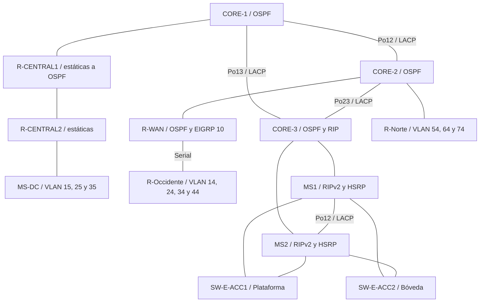
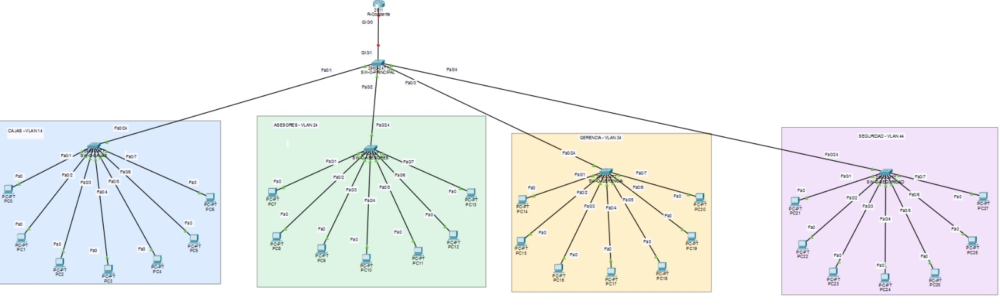
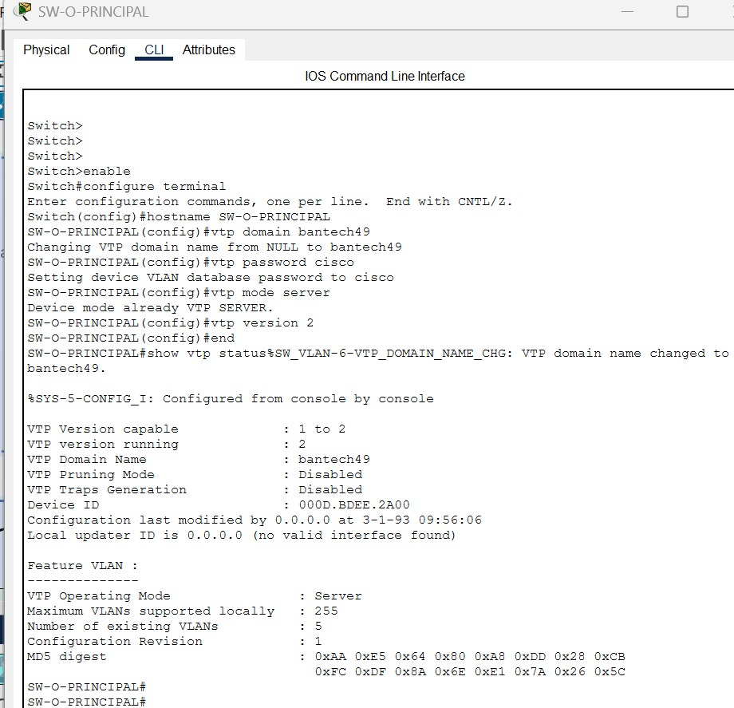
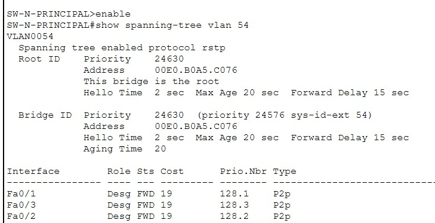

# BanTech GT

**Manual técnico · Infraestructura financiera**

Universidad de San Carlos de Guatemala · Facultad de Ingeniería · Escuela de Ciencias y Sistemas

| Curso | Proyecto | Período | Grupo |
|---|---|---|:---:|
| Redes de Computadoras 1 | Proyecto 2 | Segundo semestre de 2026 | 4 |

Manual consolidado a partir de la documentación de cada integrante y de la revisión del maestro `BanTech_GT_v1.pkt` en Packet Tracer 9.0.1. Las pruebas de integración y su alcance se registran en [Unido/VALIDACION.md](Unido/VALIDACION.md).

> **Estado de la revisión:** conectividad y mecanismos de redundancia comprobados en los escenarios registrados. El cierre de entrega tiene pendientes: habilitar el uplink de MS2, incorporar el maestro y completar las evidencias indicadas en [12.1](#121-pendientes-de-cierre).

## Contenido

| Identificación y diseño | Implementación por sede | Validación y entrega |
|---|---|---|
| [1. Integrantes](#1-integrantes) | [7. Occidente](#7-sede-occidente-agencia-regional-comercial) | [11. Pruebas y alta disponibilidad](#11-pruebas-de-conectividad-y-alta-disponibilidad) |
| [2. Parámetros](#2-parámetros-de-identificación) | [8. Norte](#8-sede-norte-centro-de-autorización-de-créditos) | [12. Estructura del repositorio](#12-estructura-del-repositorio) |
| [3. Topología general](#3-topología-general) | [9. Oriente](#9-sede-oriente-centro-financiero-legado) | [Pendientes de cierre](#121-pendientes-de-cierre) |
| [4. Backbone](#4-backbone-core) | [10. Data Center y Central](#10-data-center-y-sede-central) | [Registro de validación](Unido/VALIDACION.md) |
| [5. Direccionamiento](#5-plan-de-direccionamiento) | | |
| [6. VLANs](#6-tabla-de-vlans) | | |

---

## 1. Integrantes

| Nombre | Carné | Rol en el proyecto |
|---|---|---|
| Mariano Roberto Rac Noguera | 202101149 | Coordinador, backbone, Data Center y Sede Central |
| Oscar Vladimir Nij Cruz | 202100076 | Sede Occidente y Sede Norte |
| Luis Pablo Carlos Tapia | 20220357 | Sede Oriente, integración de la simulación y del manual |

## 2. Parámetros de identificación

El enunciado liga los parámetros de red al carné del coordinador y al número de grupo. El coordinador es Mariano (carné 202101149), por lo que XX = 49. El mismo valor se usa como segundo octeto de todo el direccionamiento, de modo que cada dirección del proyecto queda amarrada a la regla de identificación.

| Parámetro | Valor | Uso |
|---|---|---|
| XX | 49 | Dominio VTP `bantech49` y segundo octeto de la red `10.49.0.0/16` |
| Y | 4 | Grupo 4. Forma los IDs de VLAN (1Y, 2Y, 1Y+1, etc.) |
| Contraseña VTP | cisco | Sede Occidente |

Los IDs de VLAN se forman concatenando el número con Y. Con Y = 4, la VLAN 1Y es la 14 y la VLAN 1Y+1 es la 15.

## 3. Topología general



*Esquema lógico del maestro revisado: 112 dispositivos y 120 enlaces.*

> **Lectura del diagrama:** las líneas representan conexiones, no el estado instantáneo de los puertos. Durante la última prueba se encontró apagado el uplink de MS2; se habilitó temporalmente y se devolvió al estado encontrado. Debe quedar operativo para disponer de ambas salidas de Oriente.

La red se divide en un backbone nacional y cuatro redes de borde. El backbone es un núcleo de tres switches de capa 3 que corre OSPF y sirve de punto de encuentro de todos los dominios de enrutamiento. Cada sede se conecta al núcleo por medio de su propio equipo de borde, y cada una pertenece a uno de los cuatro métodos de enrutamiento exigidos.

| Sede | Dominio de enrutamiento | Equipo de borde | Se conecta a |
|---|---|---|---|
| Occidente | EIGRP 10 | R-Occidente | R-WAN (serial) |
| Norte | OSPF área 0 | R-Norte | CORE-2 |
| Oriente | RIPv2 | MS1 y MS2 | CORE-3 |
| Data Center y Central | Rutas estáticas | R-CENTRAL2 | R-CENTRAL1, que se conecta a CORE-1 |

## 4. Backbone Core

**Responsable:** Mariano Roberto Rac Noguera.

El detalle completo del backbone, del Data Center y de la Sede Central (tablas completas, extractos de todos los equipos y verificaciones) está en [Mariano/README.md](Mariano/README.md). Esta sección resume lo que afecta a todo el grupo.

<details>
<summary>Ver boceto del backbone</summary>


</details>

### 4.1 Justificación del diseño

El núcleo está formado por tres switches multicapa Cisco 3650 conectados en triángulo. Entre los equipos restantes queda un camino alternativo cuando falla un enlace o un switch del triángulo. Esta redundancia no protege las sedes cuyo único equipo de conexión al núcleo sea precisamente el que falla. Cada lado del triángulo es un EtherChannel de capa 3 de dos enlaces de fibra negociado con LACP: agrega capacidad entre flujos y permite conservar el canal ante la caída de uno de sus miembros.

Se eligió EtherChannel de capa 3 (puertos ruteados, sin `switchport`) en lugar de troncales con SVIs porque en un núcleo enrutado cada enlace queda como una red punto a punto independiente. Eso elimina Spanning Tree del núcleo, hace que la redundancia la resuelva OSPF por costo y deja un direccionamiento /30 limpio por enlace.

OSPF es el protocolo del núcleo porque es un estándar abierto, converge rápido y escala por áreas si el banco sigue creciendo. Los otros dominios se colocaron según el papel de cada sede en el negocio. Occidente usa EIGRP porque representa la expansión regional y llega al núcleo por un enlace serial WAN, que es donde EIGRP aprovecha mejor su métrica basada en ancho de banda y retardo. Oriente usa RIPv2 porque es la red del banco recién adquirido, y RIPv2 representa la red legada que se integra sin rediseñarla. Norte habla OSPF directamente con el núcleo porque el centro de autorización de créditos es crítico y conviene que no dependa de ningún punto de redistribución. El Data Center queda en un segmento de rutas estáticas por la política de aislamiento del enunciado.

La redistribución se concentra en un solo equipo por cada par de dominios. Tener un único punto entre dos protocolos evita bucles de redistribución y vuelve predecible el camino de cada ruta. Por esa misma razón MS1 y MS2 suben ambos a CORE-3, que es el único equipo que traduce entre OSPF y RIPv2.

### 4.2 Equipos del backbone

| Equipo | Modelo | Función | Protocolos | Router ID |
|---|---|---|---|---|
| CORE-1 | 3650-24PS | Núcleo, enlace hacia Sede Central | OSPF | 1.1.1.1 |
| CORE-2 | 3650-24PS | Núcleo, agrega WAN y Norte | OSPF | 2.2.2.2 |
| CORE-3 | 3650-24PS | Núcleo y punto de redistribución hacia la red legada | OSPF y RIPv2 | 3.3.3.3 |
| R-WAN | 2911 con HWIC-2T | Borde WAN y punto de redistribución hacia la expansión regional | OSPF y EIGRP 10 | 4.4.4.4 |
| R-CENTRAL1 | 2911 | Punto de redistribución del segmento estático | OSPF y estáticas | 5.5.5.5 |
| R-CENTRAL2 | 2911 | Router de acceso del Data Center | Estáticas | |

### 4.3 Medios físicos y cableado

| Medio | Dónde se usa | Motivo |
|---|---|---|
| Fibra óptica | Los tres EtherChannel del núcleo (módulos GLC-LH-SMD en Gi1/1/1 a Gi1/1/4) | Mayor ancho de banda y distancia en el canal transaccional |
| Ethernet de cobre | Enlaces del núcleo hacia los equipos de borde | Interconexión local dentro del mismo sitio |
| Serial | R-WAN hacia R-Occidente | Representa la conexión WAN hacia la región |

Los cuatro 3650 (CORE-1, CORE-2, CORE-3 y MS-DC) necesitan el módulo AC-POWER-SUPPLY para encender. R-WAN y R-Occidente llevan un módulo HWIC-2T para el enlace serial. En R-WAN el HWIC-2T está en la ranura 3, por eso su puerto serial es Se0/3/0.

| Equipo A | Puerto A | Equipo B | Puerto B | Cable | Agrupación |
|---|---|---|---|---|---|
| CORE-1 | Gi1/1/1 | CORE-2 | Gi1/1/1 | Fibra | Po12 |
| CORE-1 | Gi1/1/2 | CORE-2 | Gi1/1/2 | Fibra | Po12 |
| CORE-1 | Gi1/1/3 | CORE-3 | Gi1/1/1 | Fibra | Po13 |
| CORE-1 | Gi1/1/4 | CORE-3 | Gi1/1/2 | Fibra | Po13 |
| CORE-2 | Gi1/1/3 | CORE-3 | Gi1/1/3 | Fibra | Po23 |
| CORE-2 | Gi1/1/4 | CORE-3 | Gi1/1/4 | Fibra | Po23 |
| CORE-1 | Gi1/0/1 | R-CENTRAL1 | Gi0/0 | Cobre directo | |
| CORE-2 | Gi1/0/1 | R-WAN | Gi0/0 | Cobre directo | |
| CORE-2 | Gi1/0/2 | R-Norte | Gi0/0 | Cobre directo | Enlace ruteado |
| CORE-3 | Gi1/0/1 | MS1 | Gi1/0/1 | Cobre directo | Enlace ruteado |
| CORE-3 | Gi1/0/2 | MS2 | Gi1/0/1 | Cobre directo | Enlace ruteado de respaldo |
| R-WAN | Se0/3/0 (DCE) | R-Occidente | Se0/3/0 | Serial DCE | WAN |

### 4.4 Tabla de direcciones del backbone

Todo el backbone usa el bloque `10.49.0.0/24` dividido en subredes /30, una por enlace punto a punto. Se ocupan las primeras diez subredes y el resto queda libre para crecimiento.

| # | Enlace | Medio | Red | Extremo A | IP A | Extremo B | IP B |
|---|---|---|---|---|---|---|---|
| 1 | Po12 | Fibra, EtherChannel | 10.49.0.0/30 | CORE-1 Gi1/1/1-2 | 10.49.0.1 | CORE-2 Gi1/1/1-2 | 10.49.0.2 |
| 2 | Po13 | Fibra, EtherChannel | 10.49.0.4/30 | CORE-1 Gi1/1/3-4 | 10.49.0.5 | CORE-3 Gi1/1/1-2 | 10.49.0.6 |
| 3 | Po23 | Fibra, EtherChannel | 10.49.0.8/30 | CORE-2 Gi1/1/3-4 | 10.49.0.9 | CORE-3 Gi1/1/3-4 | 10.49.0.10 |
| 4 | CORE-1 a R-CENTRAL1 | Cobre | 10.49.0.12/30 | CORE-1 Gi1/0/1 | 10.49.0.13 | R-CENTRAL1 Gi0/0 | 10.49.0.14 |
| 5 | R-CENTRAL1 a R-CENTRAL2 | Cobre | 10.49.0.16/30 | R-CENTRAL1 Gi0/1 | 10.49.0.17 | R-CENTRAL2 Gi0/0 | 10.49.0.18 |
| 6 | CORE-2 a R-WAN | Cobre | 10.49.0.20/30 | CORE-2 Gi1/0/1 | 10.49.0.21 | R-WAN Gi0/0 | 10.49.0.22 |
| 7 | R-WAN a R-Occidente | Serial | 10.49.0.24/30 | R-WAN Se0/3/0 (DCE) | 10.49.0.25 | R-Occidente Se0/3/0 | 10.49.0.26 |
| 8 | CORE-2 a R-Norte | Cobre | 10.49.0.28/30 | CORE-2 Gi1/0/2 | 10.49.0.29 | R-Norte Gi0/0 | 10.49.0.30 |
| 9 | CORE-3 a MS1 | Cobre | 10.49.0.32/30 | CORE-3 Gi1/0/1 | 10.49.0.33 | MS1 Gi1/0/1 | 10.49.0.34 |
| 10 | CORE-3 a MS2 | Cobre | 10.49.0.36/30 | CORE-3 Gi1/0/2 | 10.49.0.37 | MS2 Gi1/0/1 | 10.49.0.38 |

Las interfaces de los switches del núcleo hacia los equipos de borde se configuran como puertos ruteados (`no switchport`). En el enlace serial, R-WAN es el extremo DCE y lleva el `clock rate`.

### 4.5 Puntos de redistribución

| Equipo | Dominios | Qué propaga |
|---|---|---|
| R-WAN | OSPF y EIGRP 10 | Redistribución mutua. Occidente aprende el resto de la red y el núcleo aprende las redes de Occidente |
| CORE-3 | OSPF y RIPv2 | Redistribución mutua. Oriente aprende el resto de la red y el núcleo aprende las redes de Oriente |
| R-CENTRAL1 | Estáticas hacia OSPF | Propaga la ruta estática del Data Center al núcleo sin exponer el segmento estático |

Cada protocolo necesita un dato distinto al recibir rutas externas. OSPF requiere la palabra `subnets` para redistribuir redes con máscara distinta a la de su clase, y como todas las redes del proyecto son subredes de 10.0.0.0/8, sin ella no se redistribuiría ninguna. EIGRP y RIP requieren una métrica explícita, porque no saben traducir el costo de OSPF y sin ella anuncian las rutas como inalcanzables. En EIGRP, `1544 2000 255 1 1500` son ancho de banda en kbps (el de un T1), retardo en decenas de microsegundos, confiabilidad, carga y MTU. En RIP, `metric 2` asigna dos saltos y deja margen bajo el límite de 15.

<details>
<summary>Ver extractos de redistribución · R-WAN, CORE-3 y R-CENTRAL1</summary>

```cisco
! R-WAN
interface Serial0/3/0
 ip address 10.49.0.25 255.255.255.252
 clock rate 64000
router ospf 1
 router-id 4.4.4.4
 network 10.49.0.20 0.0.0.3 area 0
 redistribute eigrp 10 subnets
router eigrp 10
 network 10.49.0.24 0.0.0.3
 no auto-summary
 redistribute ospf 1 metric 1544 2000 255 1 1500
!
! CORE-3
router ospf 1
 router-id 3.3.3.3
 network 10.49.0.4 0.0.0.3 area 0
 network 10.49.0.8 0.0.0.3 area 0
 redistribute rip subnets
router rip
 version 2
 no auto-summary
 network 10.0.0.0
 passive-interface Port-channel13
 passive-interface Port-channel23
 redistribute ospf 1 metric 2
!
! R-CENTRAL1
ip route 10.49.40.0 255.255.255.0 10.49.0.18
router ospf 1
 router-id 5.5.5.5
 network 10.49.0.12 0.0.0.3 area 0
 network 10.49.0.16 0.0.0.3 area 0
 passive-interface GigabitEthernet0/1
 redistribute static subnets
```

</details>

En R-CENTRAL1, `passive-interface GigabitEthernet0/1` anuncia el enlace hacia R-CENTRAL2 en OSPF pero no envía hellos por él, de modo que ningún protocolo dinámico entra al segmento de alta seguridad.

### 4.6 Vecinos OSPF y tabla de enrutamiento del núcleo

<details>
<summary>Ver evidencia · Vecinos OSPF y rutas de CORE-1</summary>


</details>

En CORE-1 los tres vecinos OSPF (2.2.2.2, 3.3.3.3 y 5.5.5.5) están en FULL. La red 10.49.0.8/30 aparece por dos caminos de costo igual (vía CORE-2 y vía CORE-3), y la ruta `O E2 10.49.40.0 [110/20]` aprendida de R-CENTRAL1 prueba que la ruta estática del Data Center se redistribuye hacia OSPF.

### 4.7 Enlaces de integración entre el backbone y las sedes

Cuatro enlaces conectan el backbone con los equipos de borde de Occidente, Norte y Oriente en el maestro integrado `BanTech_GT_v1.pkt`. Los archivos de cada integrante se conservan como entregas parciales; las pruebas entre sedes de la sección 11 corresponden al maestro abierto en Packet Tracer.

| Enlace | Extremo backbone (Mariano) | Extremo de la sede | Responsable de la sede | Red | Protocolo en ambos extremos |
|---|---|---|---|---|---|
| CORE-2 a R-Norte | CORE-2 Gi1/0/2, 10.49.0.29 | R-Norte Gi0/0, 10.49.0.30 | Oscar | 10.49.0.28/30 | OSPF 1, área 0 |
| R-WAN a R-Occidente | R-WAN Se0/3/0 (DCE, clock rate 64000), 10.49.0.25 | R-Occidente Se0/3/0 (DTE), 10.49.0.26 | Oscar | 10.49.0.24/30 | EIGRP 10 |
| CORE-3 a MS1 | CORE-3 Gi1/0/1, 10.49.0.33 | MS1 Gi1/0/1 (puerto ruteado), 10.49.0.34 | Luis | 10.49.0.32/30 | RIPv2, sin auto-summary |
| CORE-3 a MS2 | CORE-3 Gi1/0/2, 10.49.0.37 | MS2 Gi1/0/1 (puerto ruteado), 10.49.0.38 | Luis | 10.49.0.36/30 | RIPv2, sin auto-summary |

En los archivos parciales, la ausencia de cableado hacia otras sedes explica interfaces `down`. En el maestro, un enlace cableado y apagado sí requiere revisión. Al finalizar las pruebas registradas, MS1 tenía su uplink operativo, pero el de MS2 permanecía administrativamente apagado; el detalle está en la sección 11.3.

## 5. Plan de direccionamiento

### 5.1 Bloques por sede

Cada sede tiene reservado un /24 dentro de `10.49.0.0/16`, de modo que cada responsable hace su VLSM sin chocar con los demás.

| Bloque | Uso |
|---|---|
| 10.49.0.0/24 | Enlaces punto a punto del backbone |
| 10.49.10.0/24 | Sede Occidente |
| 10.49.20.0/24 | Sede Norte |
| 10.49.30.0/24 | Sede Oriente |
| 10.49.40.0/24 | Data Center y Sede Central |

### 5.2 Subneteo VLSM

En cada subred se reserva una dirección para el gateway además de los hosts requeridos. En Oriente se reservan tres, porque HSRP usa la IP virtual más una IP real en MS1 y otra en MS2. Por eso Asesores (30 hosts), Legal y Core_BD (14 hosts) y Plataforma (60 hosts) suben a la siguiente máscara.

| Sede | VLAN | Hosts requeridos | Red | Máscara | Gateway | Rango asignable | Broadcast |
|---|---|---|---|---|---|---|---|
| Occidente | Cajas | 45 | 10.49.10.0 | /26 | 10.49.10.1 | .2 a .62 | 10.49.10.63 |
| Occidente | Asesores | 30 | 10.49.10.64 | /26 | 10.49.10.65 | .66 a .126 | 10.49.10.127 |
| Occidente | Seguridad | 12 | 10.49.10.128 | /28 | 10.49.10.129 | .130 a .142 | 10.49.10.143 |
| Occidente | Gerencia | 10 | 10.49.10.144 | /28 | 10.49.10.145 | .146 a .158 | 10.49.10.159 |
| Norte | Análisis | 50 | 10.49.20.0 | /26 | 10.49.20.1 | .2 a .62 | 10.49.20.63 |
| Norte | Auditoría | 25 | 10.49.20.64 | /27 | 10.49.20.65 | .66 a .94 | 10.49.20.95 |
| Norte | Legal | 14 | 10.49.20.96 | /27 | 10.49.20.97 | .98 a .126 | 10.49.20.127 |
| Oriente | Plataforma | 60 | 10.49.30.0 | /25 | 10.49.30.1 (virtual) | .4 a .126 | 10.49.30.127 |
| Oriente | Bóveda | 40 | 10.49.30.128 | /26 | 10.49.30.129 (virtual) | .132 a .190 | 10.49.30.191 |
| Central | Web_Apps | 28 | 10.49.40.0 | /27 | 10.49.40.1 | .2 a .30 | 10.49.40.31 |
| Central | Core_BD | 14 | 10.49.40.32 | /27 | 10.49.40.33 | .34 a .62 | 10.49.40.63 |
| Central | NOC | 10 | 10.49.40.64 | /28 | 10.49.40.65 | .66 a .78 | 10.49.40.79 |
| Central | Enlace R-CENTRAL2 a MS-DC | 2 | 10.49.40.80 | /30 | | .81 y .82 | 10.49.40.83 |

En Oriente, MS1 usa .2 y MS2 usa .3 en Plataforma, y MS1 usa .130 y MS2 usa .131 en Bóveda.

Las redes, máscaras y direcciones de gateway de esta tabla coinciden con el inventario de interfaces consultado durante la revisión del maestro. En Oriente, el gateway de los hosts es la dirección virtual HSRP, no la dirección real de MS1 o MS2.

## 6. Tabla de VLANs

Los IDs se forman con Y = 4. Los nombres van sin tilde para evitar problemas en IOS.

| ID | Fórmula | Nombre | Sede | Red |
|---|---|---|---|---|
| 14 | 1Y | Cajas | Occidente | 10.49.10.0/26 |
| 24 | 2Y | Asesores | Occidente | 10.49.10.64/26 |
| 34 | 3Y | Gerencia | Occidente | 10.49.10.144/28 |
| 44 | 4Y | Seguridad | Occidente | 10.49.10.128/28 |
| 54 | 5Y | Analisis | Norte | 10.49.20.0/26 |
| 64 | 6Y | Auditoria | Norte | 10.49.20.64/27 |
| 74 | 7Y | Legal | Norte | 10.49.20.96/27 |
| 84 | 8Y | Boveda | Oriente | 10.49.30.128/26 |
| 94 | 9Y | Plataforma | Oriente | 10.49.30.0/25 |
| 15 | 1Y+1 | Core_BD | Central | 10.49.40.32/27 |
| 25 | 2Y+1 | Web_Apps | Central | 10.49.40.0/27 |
| 35 | 3Y+1 | NOC | Central | 10.49.40.64/28 |

## 7. Sede Occidente, Agencia Regional Comercial

**Responsable:** Oscar Vladimir Nij Cruz. **Tecnologías:** VLAN · VTP v2 · Router-on-a-Stick · EIGRP 10.

<details>
<summary>Ver evidencia del parcial · Cableado de Occidente</summary>



</details>

Fuente de la sede y galería completa: [Oscar/seccion.md](Oscar/seccion.md). Las capturas originales documentan la entrega parcial; las pruebas del maestro se distinguen en la sección 11.

### 7.1 Justificación de la arquitectura

Occidente utiliza una estrella con un switch principal y cuatro switches de acceso, uno por departamento. Las VLANs CAJAS, ASESORES, GERENCIA y SEGURIDAD separan dominios de broadcast; una falla del switch o enlace de acceso de Asesores queda localizada y no desconecta el acceso de Cajas. El enlace compartido hacia el router y el switch principal siguen siendo puntos únicos de falla: la segmentación no equivale a redundancia física ni a filtrado de seguridad.

R-Occidente hace Router-on-a-Stick con subinterfaces 802.1Q y anuncia las cuatro redes mediante EIGRP AS 10 sobre el enlace serial a R-WAN. El switch principal administra las VLANs como servidor VTP v2 y los cuatro switches de acceso funcionan como clientes. La revisión operativa confirmó dominio `bantech49`, revisión 9 y el mismo resumen MD5 en los cinco switches. Norte usa una base VTP independiente: ambas sedes se unen por capa 3, no por un troncal entre sus switches.

### 7.2 Mapeo lógico

| Equipo | Función | Enlaces troncales 802.1Q | Puertos de acceso |
|---|---|---|---|
| R-Occidente | Router de borde e inter-VLAN | Gi0/0, subinterfaces .14, .24, .34 y .44 | Ninguno; Se0/3/0 es el enlace WAN ruteado |
| SW-O-PRINCIPAL | Concentración, VTP servidor | Fa0/1–4 hacia acceso; Gi0/1 hacia R-Occidente; VLANs 14,24,34,44 | Ninguno de usuarios |
| SW-O-CAJAS | Acceso, VTP cliente | Fa0/24; VLANs 14,24,34,44 | Fa0/1–7, VLAN 14; PC0–PC6 |
| SW-O-ASESORES | Acceso, VTP cliente | Fa0/24; VLANs 14,24,34,44 | Fa0/1–7, VLAN 24; PC7–PC13 |
| SW-O-GERENCIA | Acceso, VTP cliente | Fa0/24; VLANs 14,24,34,44 | Fa0/1–7, VLAN 34; PC14–PC20 |
| SW-O-SEGURIDAD | Acceso, VTP cliente | Fa0/24; VLANs 14,24,34,44 | Fa0/1–7, VLAN 44; PC21–PC27 |

<details>
<summary>Ver evidencia del parcial · Servidor VTP de Occidente</summary>



</details>

### 7.3 Extractos de configuración

<details>
<summary>Ver configuración · Subinterfaces, EIGRP y VTP</summary>

```cisco
! R-Occidente: extracto de direccionamiento y anuncios
interface GigabitEthernet0/0
 no ip address
 no shutdown
interface GigabitEthernet0/0.14
 encapsulation dot1Q 14
 ip address 10.49.10.1 255.255.255.192
interface GigabitEthernet0/0.24
 encapsulation dot1Q 24
 ip address 10.49.10.65 255.255.255.192
interface GigabitEthernet0/0.34
 encapsulation dot1Q 34
 ip address 10.49.10.145 255.255.255.240
interface GigabitEthernet0/0.44
 encapsulation dot1Q 44
 ip address 10.49.10.129 255.255.255.240
router eigrp 10
 network 10.49.0.24 0.0.0.3
 network 10.49.10.0 0.0.0.63
 network 10.49.10.64 0.0.0.63
 network 10.49.10.128 0.0.0.15
 network 10.49.10.144 0.0.0.15
 passive-interface GigabitEthernet0/0.14
 passive-interface GigabitEthernet0/0.24
 passive-interface GigabitEthernet0/0.34
 passive-interface GigabitEthernet0/0.44
!
! SW-O-PRINCIPAL; en los switches de acceso el modo es client
vtp domain bantech49
vtp version 2
vtp password cisco
vtp mode server
vlan 14
 name CAJAS
vlan 24
 name ASESORES
vlan 34
 name GERENCIA
vlan 44
 name SEGURIDAD
```

</details>

La interfaz física Gi0/0 no necesita IP propia: las direcciones pertenecen a las subinterfaces. La prueba integrada PC0 → PC7 (`10.49.10.66`) terminó con 4/4 respuestas.

## 8. Sede Norte, Centro de Autorización de Créditos

**Responsable:** Oscar Vladimir Nij Cruz. **Tecnologías:** Rapid PVST+ · VTP v2 · Router-on-a-Stick · OSPF.

<details>
<summary>Ver evidencia del parcial · Root Bridge de Norte</summary>



</details>

### 8.1 Justificación de la arquitectura

Norte combina los enlaces directos de los tres switches de acceso al principal con enlaces redundantes entre los switches de acceso. Rapid PVST+ mantiene un árbol por VLAN y bloquea los caminos alternativos que crearían bucles. SW-N-PRINCIPAL es la raíz de las VLANs 54, 64 y 74 con prioridad base 24576; la prioridad mostrada incluye el ID de VLAN (por ejemplo, 24630 para la VLAN 54).

Si falla el enlace directo de Análisis hacia el principal, el tráfico puede atravesar otro switch de acceso. Esto elimina la dependencia de ese único enlace, pero no duplica R-Norte ni el switch de acceso al que se conecta cada PC. La prueba sobre el maestro confirmó que Fa0/23 de SW-N-ANALISIS pasó de `Altn BLK` a `Root FWD` al apagar Fa0/24.

### 8.2 Mapeo lógico

| Equipo | Función | Enlaces troncales 802.1Q | Puertos de acceso |
|---|---|---|---|
| R-Norte | Borde OSPF e inter-VLAN | Gi0/1, subinterfaces .54, .64 y .74 | Ninguno; Gi0/0 conecta con CORE-2 |
| SW-N-PRINCIPAL | Root Bridge, VTP servidor | Fa0/1 hacia Análisis, Fa0/2 hacia Auditoría, Fa0/3 hacia Legal; Gi0/1 hacia R-Norte | Ninguno de usuarios |
| SW-N-ANALISIS | Acceso, VTP cliente | Fa0/22–23 entre acceso; Fa0/24 al principal | Fa0/1–7, VLAN 54; PC-A1–PC-A7 |
| SW-N-AUDITORIA | Acceso, VTP cliente | Fa0/22–23 entre acceso; Fa0/24 al principal | Fa0/1–7, VLAN 64; PC-U1–PC-U7 |
| SW-N-LEGAL | Acceso, VTP cliente | Fa0/22–23 entre acceso; Fa0/24 al principal | Fa0/1–7, VLAN 74; PC-L1–PC-L7 |

Todos los troncales de usuarios de Norte permiten las VLANs 54,64,74. La revisión de VTP v2 confirmó servidor y tres clientes con dominio `bantech49`, revisión 7, ocho VLANs totales y el mismo resumen MD5. Las diferencias de revisión respecto de Occidente son esperadas porque no comparten un dominio de capa 2.

### 8.3 Extractos de configuración

<details>
<summary>Ver configuración · Rapid PVST+, VLANs y OSPF</summary>

```cisco
! SW-N-PRINCIPAL
spanning-tree mode rapid-pvst
spanning-tree vlan 54,64,74 priority 24576
vlan 54
 name ANALISIS
vlan 64
 name AUDITORIA
vlan 74
 name LEGAL
!
! R-Norte
interface GigabitEthernet0/1.54
 encapsulation dot1Q 54
 ip address 10.49.20.1 255.255.255.192
interface GigabitEthernet0/1.64
 encapsulation dot1Q 64
 ip address 10.49.20.65 255.255.255.224
interface GigabitEthernet0/1.74
 encapsulation dot1Q 74
 ip address 10.49.20.97 255.255.255.224
router ospf 1
 router-id 10.49.0.30
 network 10.49.0.28 0.0.0.3 area 0
 network 10.49.20.0 0.0.0.63 area 0
 network 10.49.20.64 0.0.0.31 area 0
 network 10.49.20.96 0.0.0.31 area 0
 passive-interface GigabitEthernet0/1.54
 passive-interface GigabitEthernet0/1.64
 passive-interface GigabitEthernet0/1.74
```

</details>

La evidencia de inter-VLAN de la entrega parcial está en [Análisis → Legal](Oscar/capturas/52_Ping_InterVLAN_Analisis_Legal.jpeg). Las pruebas integradas hacia otras sedes se registran en la sección 11.

## 9. Sede Oriente, Centro Financiero Legado

**Responsable:** Luis Pablo Carlos Tapia. **Tecnologías:** HSRP · RIPv2 · LACP · Rapid PVST+.

El esquema de la sección 3 muestra la doble conexión de los switches de acceso a MS1 y MS2. El mapeo siguiente fue contrastado con `show interfaces trunk`, `show vlan brief` y `show cdp neighbors` en los switches de acceso del maestro.

### 9.1 Justificación de la arquitectura

Oriente conserva RIPv2 como dominio legado y usa dos switches multicapa con `ip routing`. MS1 y MS2 se interconectan mediante Po12, un EtherChannel LACP de dos enlaces que transporta las VLANs 84 y 94. Cada switch de acceso conecta con ambos distribuidores; Rapid PVST+ evita bucles y conserva caminos alternativos.

HSRP presenta un gateway virtual estable a los hosts: `10.49.30.129` para Bóveda y `10.49.30.1` para Plataforma. MS1 usa prioridad 105 y MS2 prioridad 100, ambos con `preempt`. MS1 sigue su uplink Gi1/0/1 con decremento 10: al perderlo queda en 95 y MS2 puede tomar el rol activo si su propia salida está disponible. Al recuperar el enlace, MS1 vuelve a 105 y recupera el rol activo. Esta política fue comprobada con una falla del uplink; no se ejecutó una prueba de pérdida total de energía de MS1.

Ambos distribuidores conectan a CORE-3 mediante enlaces ruteados /30 y anuncian las redes con RIPv2, versión 2 y `no auto-summary`. Las SVIs de usuarios son pasivas para no enviarles actualizaciones RIP. El diseño protege frente a la pérdida de un distribuidor o de un camino, pero CORE-3 sigue siendo el punto común de salida de Oriente.

### 9.2 Mapeo lógico

| Equipo | Función | Enlaces troncales 802.1Q | Puertos de acceso |
|---|---|---|---|
| MS1 | Distribución, HSRP preferido | Po12 (Gi1/0/2–3) a MS2; Gi1/0/4 a ACC1; Gi1/0/5 a ACC2 | Ninguno; Gi1/0/1 es ruteado hacia CORE-3 |
| MS2 | Distribución, respaldo HSRP | Po12 (Gi1/0/2–3) a MS1; Gi1/0/4 a ACC1; Gi1/0/5 a ACC2 | Ninguno; Gi1/0/1 es ruteado hacia CORE-3 |
| SW-E-ACC1 | Acceso de Plataforma | Gi0/1 a MS1 Gi1/0/4; Gi0/2 a MS2 Gi1/0/4 | Fa0/1–7, VLAN 94; PLAT1–PLAT7 |
| SW-E-ACC2 | Acceso de Bóveda | Gi0/1 a MS1 Gi1/0/5; Gi0/2 a MS2 Gi1/0/5 | Fa0/1–7, VLAN 84; BOV1–BOV7 |

Los troncales de Oriente permiten únicamente las VLANs 84,94 y utilizan VLAN nativa 1. Los puertos bloqueados por STP no son enlaces físicamente caídos. Las interfaces de acceso no utilizadas no forman parte de las VLANs de usuarios.

### 9.3 Extractos de configuración

El siguiente extracto resume los parámetros de direccionamiento, HSRP y RIP revisados; no es un volcado completo para reemplazar la configuración del equipo.

<details>
<summary>Ver configuración · MS1 y MS2</summary>

```cisco
! MS1
ip routing
interface GigabitEthernet1/0/1
 no switchport
 ip address 10.49.0.34 255.255.255.252
interface Vlan84
 ip address 10.49.30.130 255.255.255.192
 standby 84 ip 10.49.30.129
 standby 84 priority 105
 standby 84 preempt
 standby 84 track GigabitEthernet1/0/1
interface Vlan94
 ip address 10.49.30.2 255.255.255.128
 standby 94 ip 10.49.30.1
 standby 94 priority 105
 standby 94 preempt
 standby 94 track GigabitEthernet1/0/1
router rip
 version 2
 network 10.0.0.0
 passive-interface Vlan84
 passive-interface Vlan94
 no auto-summary
!
! MS2: prioridad HSRP predeterminada 100
ip routing
interface GigabitEthernet1/0/1
 no switchport
 ip address 10.49.0.38 255.255.255.252
interface Vlan84
 ip address 10.49.30.131 255.255.255.192
 standby 84 ip 10.49.30.129
 standby 84 preempt
interface Vlan94
 ip address 10.49.30.3 255.255.255.128
 standby 94 ip 10.49.30.1
 standby 94 preempt
router rip
 version 2
 network 10.0.0.0
 passive-interface Vlan84
 passive-interface Vlan94
 no auto-summary
```

</details>

> **Pendiente operativo:** durante la revisión MS2 redujo su prioridad efectiva a 90 con su uplink apagado. Para habilitar la salida redundante debe aplicarse `no shutdown` a Gi1/0/1 de MS2, comprobar el estado `up/up` y repetir la validación antes de guardar el maestro de entrega.

## 10. Data Center y Sede Central

**Responsable:** Mariano Roberto Rac Noguera. **Tecnologías:** rutas estáticas · SVIs · LACP.

El detalle completo de esta sede está en [Mariano/README.md](Mariano/README.md).

<details>
<summary>Ver evidencia · Cableado del Data Center</summary>


</details>

### 10.1 Justificación de la arquitectura

La sede usa dos routers con funciones separadas. R-CENTRAL2 es el router de acceso del Data Center y solo conoce rutas estáticas: una ruta por defecto hacia R-CENTRAL1 y tres rutas estáticas explícitas, una por cada VLAN de servidores (10.49.40.0/27, 10.49.40.32/27 y 10.49.40.64/28), a través de MS-DC. R-CENTRAL1 recibe el segmento con una sola ruta estática resumida (`10.49.40.0/24`) y la redistribuye en OSPF. De esta forma el resto de la red alcanza a los servidores sin que ningún protocolo dinámico entre al segmento de alta seguridad.

MS-DC es el switch de distribución de los servidores y hace el enrutamiento inter-VLAN con SVIs para Core_BD, Web_Apps y NOC. Hacia cada uno de los dos switches de acceso sube por un EtherChannel LACP de dos cables. Eso responde a la necesidad de sumar capacidad ante las ráfagas de tráfico y además tolera la caída de un cable sin cortar el servicio. SW-DC-ACC1 concentra los servidores de base de datos y de banca virtual, y SW-DC-ACC2 concentra los equipos de monitoreo del NOC, de modo que el tráfico de operación no compite con el de los servidores en el mismo canal.

### 10.2 Mapeo lógico

| Equipo | Función | Enlaces troncales 802.1Q | Puertos de acceso |
|---|---|---|---|
| R-CENTRAL1 | Redistribución del segmento estático hacia OSPF | Ninguno (puertos ruteados) | Ninguno |
| R-CENTRAL2 | Router de acceso del Data Center, rutas estáticas | Ninguno (puertos ruteados) | Ninguno |
| MS-DC | Switch principal de distribución e inter-VLAN | Po1 (Gi1/0/2-3) y Po2 (Gi1/0/4-5) | Ninguno |
| SW-DC-ACC1 | Acceso de servidores | Po1 (Gi0/1-2) | Fa0/1-7 VLAN 15 Core_BD, Fa0/8-14 VLAN 25 Web_Apps |
| SW-DC-ACC2 | Acceso del NOC | Po2 (Gi0/1-2) | Fa0/1-7 VLAN 35 NOC |

### 10.3 Cableado

| Equipo A | Puerto A | Equipo B | Puerto B | Cable | Agrupación |
|---|---|---|---|---|---|
| R-CENTRAL1 | Gi0/1 | R-CENTRAL2 | Gi0/0 | Cobre directo | |
| R-CENTRAL2 | Gi0/1 | MS-DC | Gi1/0/1 | Cobre directo | |
| MS-DC | Gi1/0/2 | SW-DC-ACC1 | Gi0/1 | Cobre directo | Po1 |
| MS-DC | Gi1/0/3 | SW-DC-ACC1 | Gi0/2 | Cobre directo | Po1 |
| MS-DC | Gi1/0/4 | SW-DC-ACC2 | Gi0/1 | Cobre directo | Po2 |
| MS-DC | Gi1/0/5 | SW-DC-ACC2 | Gi0/2 | Cobre directo | Po2 |
| SW-DC-ACC1 | Fa0/1 a Fa0/7 | BD1 a BD7 | Fa0 | Cobre directo | VLAN Core_BD |
| SW-DC-ACC1 | Fa0/8 a Fa0/14 | WEB1 a WEB7 | Fa0 | Cobre directo | VLAN Web_Apps |
| SW-DC-ACC2 | Fa0/1 a Fa0/7 | NOC1 a NOC7 | Fa0 | Cobre directo | VLAN NOC |

Cada equipo final va en el puerto con su mismo número. Por ejemplo, BD1 va en Fa0/1, BD7 en Fa0/7, WEB1 en Fa0/8 y WEB7 en Fa0/14.

### 10.4 Direccionamiento de interfaces

| Equipo | Interfaz | Dirección IP | Máscara | Descripción |
|---|---|---|---|---|
| R-CENTRAL1 | Gi0/0 | 10.49.0.14 | 255.255.255.252 | Hacia CORE-1 |
| R-CENTRAL1 | Gi0/1 | 10.49.0.17 | 255.255.255.252 | Hacia R-CENTRAL2 |
| R-CENTRAL2 | Gi0/0 | 10.49.0.18 | 255.255.255.252 | Hacia R-CENTRAL1 |
| R-CENTRAL2 | Gi0/1 | 10.49.40.81 | 255.255.255.252 | Hacia MS-DC |
| MS-DC | Gi1/0/1 | 10.49.40.82 | 255.255.255.252 | Puerto ruteado hacia R-CENTRAL2 |
| MS-DC | Vlan25 (Web_Apps) | 10.49.40.1 | 255.255.255.224 | Gateway de WEB1 a WEB7 |
| MS-DC | Vlan15 (Core_BD) | 10.49.40.33 | 255.255.255.224 | Gateway de BD1 a BD7 |
| MS-DC | Vlan35 (NOC) | 10.49.40.65 | 255.255.255.240 | Gateway de NOC1 a NOC7 |

### 10.5 Direccionamiento de equipos finales

| Equipo | VLAN | Dirección IP | Máscara | Gateway |
|---|---|---|---|---|
| BD1 | Core_BD | 10.49.40.34 | 255.255.255.224 | 10.49.40.33 |
| BD2 | Core_BD | 10.49.40.35 | 255.255.255.224 | 10.49.40.33 |
| BD3 | Core_BD | 10.49.40.36 | 255.255.255.224 | 10.49.40.33 |
| BD4 | Core_BD | 10.49.40.37 | 255.255.255.224 | 10.49.40.33 |
| BD5 | Core_BD | 10.49.40.38 | 255.255.255.224 | 10.49.40.33 |
| BD6 | Core_BD | 10.49.40.39 | 255.255.255.224 | 10.49.40.33 |
| BD7 | Core_BD | 10.49.40.40 | 255.255.255.224 | 10.49.40.33 |
| WEB1 | Web_Apps | 10.49.40.2 | 255.255.255.224 | 10.49.40.1 |
| WEB2 | Web_Apps | 10.49.40.3 | 255.255.255.224 | 10.49.40.1 |
| WEB3 | Web_Apps | 10.49.40.4 | 255.255.255.224 | 10.49.40.1 |
| WEB4 | Web_Apps | 10.49.40.5 | 255.255.255.224 | 10.49.40.1 |
| WEB5 | Web_Apps | 10.49.40.6 | 255.255.255.224 | 10.49.40.1 |
| WEB6 | Web_Apps | 10.49.40.7 | 255.255.255.224 | 10.49.40.1 |
| WEB7 | Web_Apps | 10.49.40.8 | 255.255.255.224 | 10.49.40.1 |
| NOC1 | NOC | 10.49.40.66 | 255.255.255.240 | 10.49.40.65 |
| NOC2 | NOC | 10.49.40.67 | 255.255.255.240 | 10.49.40.65 |
| NOC3 | NOC | 10.49.40.68 | 255.255.255.240 | 10.49.40.65 |
| NOC4 | NOC | 10.49.40.69 | 255.255.255.240 | 10.49.40.65 |
| NOC5 | NOC | 10.49.40.70 | 255.255.255.240 | 10.49.40.65 |
| NOC6 | NOC | 10.49.40.71 | 255.255.255.240 | 10.49.40.65 |
| NOC7 | NOC | 10.49.40.72 | 255.255.255.240 | 10.49.40.65 |

### 10.6 Extractos de configuración

<details>
<summary>Ver configuración · Routers de Central y MS-DC</summary>

```cisco
! R-CENTRAL1
ip route 10.49.40.0 255.255.255.0 10.49.0.18
!
! R-CENTRAL2
ip route 0.0.0.0 0.0.0.0 10.49.0.17
ip route 10.49.40.0 255.255.255.224 10.49.40.82
ip route 10.49.40.32 255.255.255.224 10.49.40.82
ip route 10.49.40.64 255.255.255.240 10.49.40.82
!
! MS-DC
ip routing
interface range GigabitEthernet1/0/2 - 3
 switchport mode trunk
 channel-group 1 mode active
interface Port-channel1
 switchport mode trunk
 switchport trunk allowed vlan 15,25,35
interface range GigabitEthernet1/0/4 - 5
 switchport mode trunk
 channel-group 2 mode active
interface Port-channel2
 switchport mode trunk
 switchport trunk allowed vlan 15,25,35
interface Vlan15
 ip address 10.49.40.33 255.255.255.224
interface Vlan25
 ip address 10.49.40.1 255.255.255.224
interface Vlan35
 ip address 10.49.40.65 255.255.255.240
ip route 0.0.0.0 0.0.0.0 10.49.40.81
```

</details>

### 10.7 Verificación

<details>
<summary>Ver evidencia · EtherChannel en MS-DC</summary>


</details>

En MS-DC, Po1 y Po2 aparecen en (SU) con sus cuatro puertos en (P) negociados por LACP, y en la misma consola Vlan15, Vlan25 y Vlan35 cambian a up en interfaz y protocolo de línea.

## 11. Pruebas de conectividad y alta disponibilidad

| Comprobación | Resultado registrado | Condición de cierre |
|---|---|---|
| Pings representativos | Respuestas completas en los caminos confirmados | Dos pruebas adicionales pendientes |
| HSRP | MS2 asumió ambos gateways al caer el uplink de MS1 | Requiere el uplink de MS2 habilitado |
| Rapid PVST+ | Camino alternativo en reenvío y retorno al enlace directo | Enlace de prueba restaurado |
| EtherChannel | Canales LACP en uso y dos miembros agrupados por canal | Estado operativo observado |
| VTP | Bases coincidentes dentro de cada sede | Estado operativo observado |

**Evidencia detallada:** [registro de validación del maestro](Unido/VALIDACION.md). Las capturas de los parciales están identificadas como tales.

### 11.1 Convergencia de extremo a extremo

| Ruta entre sedes | Origen | Destino | Respuestas | Estado |
|---|---|---|:---:|---|
| Occidente → Data Center | PC0 · `10.49.10.2` | WEB1 · `10.49.40.2` | 4/4 | Confirmado |
| Norte → Oriente | PC-A1 · `10.49.20.2` | BOV1 · `10.49.30.132` | 4/4 | Confirmado en repetición |
| Oriente → Data Center | PLAT1 · `10.49.30.4` | BD1 · `10.49.40.34` | 4/4 | Confirmado en repetición |
| Norte → Data Center | PC-A1 · `10.49.20.2` | WEB1 · `10.49.40.2` | 4/4 | Confirmado |
| Occidente → Norte | PC0 · `10.49.10.2` | PC-A1 · `10.49.20.2` | — | Pendiente: timeout del canal |

Los pings completos de hosts registraron 0 % de pérdida. [Consultar resultados y observaciones de cada ejecución](Unido/VALIDACION.md#1-conectividad). Para confirmar la última fila, repetir `ping 10.49.20.2` desde PC0.

Los resultados corresponden a pings reales ejecutados en el maestro durante la revisión. En algunas primeras pruebas hubo pérdida y las repeticiones pasaron completas; es compatible con resolución ARP inicial, sin que se haya aislado esa causa. Un timeout del canal de verificación no equivale a una respuesta ICMP fallida. Esta matriz es una muestra de los caminos indicados, no una prueba de todas las parejas de hosts.

### 11.2 Enrutamiento inter-VLAN por sede

<details>
<summary>Ver evidencia · Pruebas PDU del Data Center</summary>


</details>

En el Data Center (Mariano), las seis pruebas de PDU terminaron en Successful: BD1 a BD7, WEB1 a WEB7 y NOC1 a NOC7 dentro de cada VLAN, BD1 a WEB1 entre VLANs en el mismo switch de acceso, y NOC1 a BD1 y NOC7 a WEB7 entre VLANs de switches de acceso distintos.

En Occidente, PC0 → PC7 (`10.49.10.66`) terminó con 4/4 respuestas en la repetición sobre el maestro. La [captura original Cajas → Asesores](Oscar/capturas/20_Ping_InterVLAN_Cajas_Asesores.jpeg) corresponde al archivo parcial. En Norte existen capturas de [Análisis → Auditoría](Oscar/capturas/51_Ping_InterVLAN_Analisis_Auditoria.jpeg) y [Auditoría → Legal](Oscar/capturas/53_Ping_InterVLAN_Auditoria_Legal.jpeg), también del parcial.

En Oriente se verificaron salidas desde Plataforma y Bóveda al Data Center durante la conmutación. Queda por registrar una prueba directa Plataforma → Bóveda (`PLAT1` → `10.49.30.132`) como evidencia específica de inter-VLAN de la sede; no se sustituye por los pings hacia otras sedes.

### 11.3 Conmutación por error

#### HSRP: pérdida del uplink de MS1

| Fase | MS1 | MS2 / conectividad |
|---|---|---|
| Respaldo disponible | Activo, prioridad 105 | En espera, prioridad 100 |
| Uplink de MS1 apagado | Prioridad reducida a 95 | Activo en VLAN 84 y 94; pings 4/4 |
| Uplink de MS1 restaurado | Activo nuevamente, prioridad 105 | MS1 recupera el rol por `preempt` |

Se apagó temporalmente Gi1/0/1 de MS1. La primera prueba encontró también apagado el uplink de MS2 y perdió 3 de 4 paquetes; ese escenario no valida redundancia de salida. Al habilitar temporalmente el uplink de MS2 y repetir la caída de MS1, la prioridad de MS1 bajó de 105 a 95 y `show standby brief` confirmó a MS2 activo en los grupos 84 y 94, con prioridad 100.

Con MS2 activo, PLAT1 → BD1 y BOV1 → WEB1 respondieron 4/4. Al restaurar el uplink de MS1, este recuperó prioridad 105 y el rol activo por `preempt`. La prueba demuestra conectividad después de la conmutación; no mide el tiempo exacto de interrupción ni prueba una caída total de energía del distribuidor.

> **Estado de cierre de esa prueba:** el uplink de MS1 quedó restaurado y el de MS2 se devolvió al estado apagado encontrado durante la revisión. La red conserva conectividad por MS1, pero para entregar redundancia operativa se debe habilitar el uplink de MS2 y verificarlo.

[Ver extractos observados y procedimiento de repetición HSRP](Unido/VALIDACION.md#2-hsrp).

#### Rapid PVST+: pérdida del enlace directo de Análisis

| Fase | Fa0/24 | Fa0/23 | Costo a la raíz |
|---|---|---|:---:|
| Inicial | `Root FWD` | `Altn BLK` | 19 |
| Falla del enlace directo | Apagado | `Root FWD` | 38 |
| Restauración | `Root FWD` | `Altn BLK` | 19 |

En SW-N-ANALISIS se apagó Fa0/24, que inicialmente era `Root FWD` con costo 19 hacia la raíz. Fa0/23 pasó de `Altn BLK` a `Root FWD` y el costo de ruta subió a 38. PC-A1 → WEB1 respondió 4/4 durante la falla. Tras restaurar Fa0/24, el enlace directo volvió a `Root FWD`, costo 19, y Fa0/23 volvió a `Altn BLK`.

El [registro del maestro](Unido/VALIDACION.md#3-rapid-pvst) contiene los estados observados. Las capturas de [falla](Oscar/capturas/60_RapidPVST_Recuperacion_Enlace_Norte.jpeg), [ping](Oscar/capturas/61_Ping_Recuperacion_RapidPVST_Norte.jpeg) y [restauración](Oscar/capturas/62_RapidPVST_Enlace_Restaurado_Norte.jpeg) son antecedentes del archivo parcial y no capturas nuevas del maestro. El puerto alternativo puede diferir entre copias de la topología.

### 11.4 Estado operativo de EtherChannel y VTP

`show etherchannel summary` confirmó LACP en ambos extremos de todos los canales revisados: Po12/Po13/Po23 del núcleo en `RU`, Po12 entre MS1/MS2 en `SU` y Po1/Po2 del Data Center en `SU`. Cada canal tenía dos puertos miembros `(P)`. `U` significa en uso, `R` capa 3 y `S` capa 2; no se observaron miembros independientes o suspendidos en esas salidas.

`show vtp status` confirmó las bases sincronizadas dentro de Occidente (revisión 9) y Norte (revisión 7). Las tablas y extractos están en [Unido/VALIDACION.md](Unido/VALIDACION.md). La observación de canales agrupados no sustituye una prueba de caída de un miembro de cada EtherChannel, que no se ejecutó en esta revisión.

## 12. Estructura del repositorio

```text
README.md                              manual técnico consolidado
Images/                                boceto y capturas de backbone y Data Center
Mariano/
  BanTechGT.pkt                        entrega parcial de backbone y Central
  README.md                            detalle técnico de Mariano
  README-BACKBONE.md                    documentación complementaria
  TareasMariano.md                      planificación original
Oscar/
  BanTechGT_Sedes_Oscar_Grupo4.pkt       entrega parcial de Occidente y Norte
  seccion.md                           detalle técnico y evidencias del parcial
  capturas/                            imágenes originales de Occidente y Norte
  TareasOscar.md                        planificación original
Luis/
  TareasLuis.md                         planificación original
Unido/
  CORE.conf                            archivo existente vacío, no es respaldo
  VALIDACION.md                        registro textual de pruebas del maestro
```

Esta estructura corresponde a los archivos presentes en la copia revisada. El maestro abierto se identificó como `Unido/BanTech_GT_v1.pkt` en otra ubicación local; ese archivo no está incluido en esta copia del repositorio. Debe incorporarse el maestro definitivo en `Unido/` antes de la entrega, con ambos uplinks de Oriente operativos y la configuración guardada. Las carpetas `sedes/` e `img/` de la planificación original no existen en esta estructura.

### 12.1 Pendientes de cierre

- [ ] **Archivo de entrega:** incorporar el `.pkt` maestro definitivo en el repositorio y verificar su reapertura.
- [ ] **Redundancia de Oriente:** habilitar y validar el uplink de MS2 hacia CORE-3; repetir el chequeo de salud y guardar el maestro.
- [ ] **Pings pendientes:** confirmar PC0 → PC-A1 y registrar el ping inter-VLAN PLAT1 → BOV1.
- [ ] **Evidencias gráficas:** añadir capturas nuevas del maestro para la matriz de pings y las pruebas HSRP/STP si se requieren; el registro textual conserva los resultados ya observados.

---

[Volver al contenido](#contenido) · [Abrir registro de validación](Unido/VALIDACION.md)
