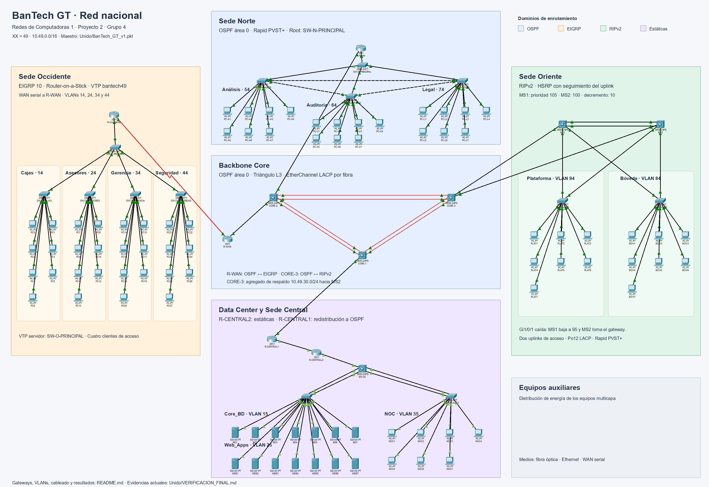
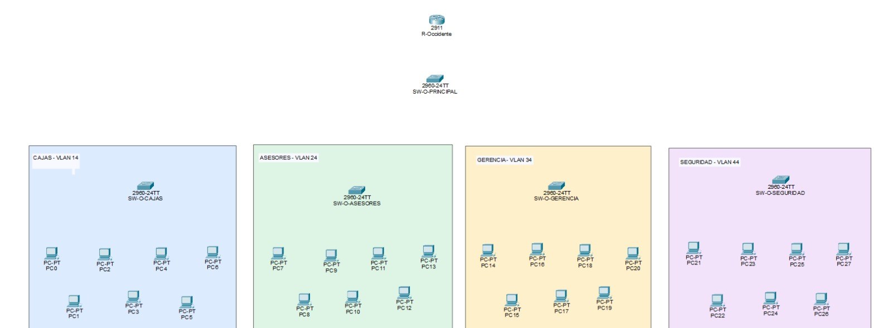
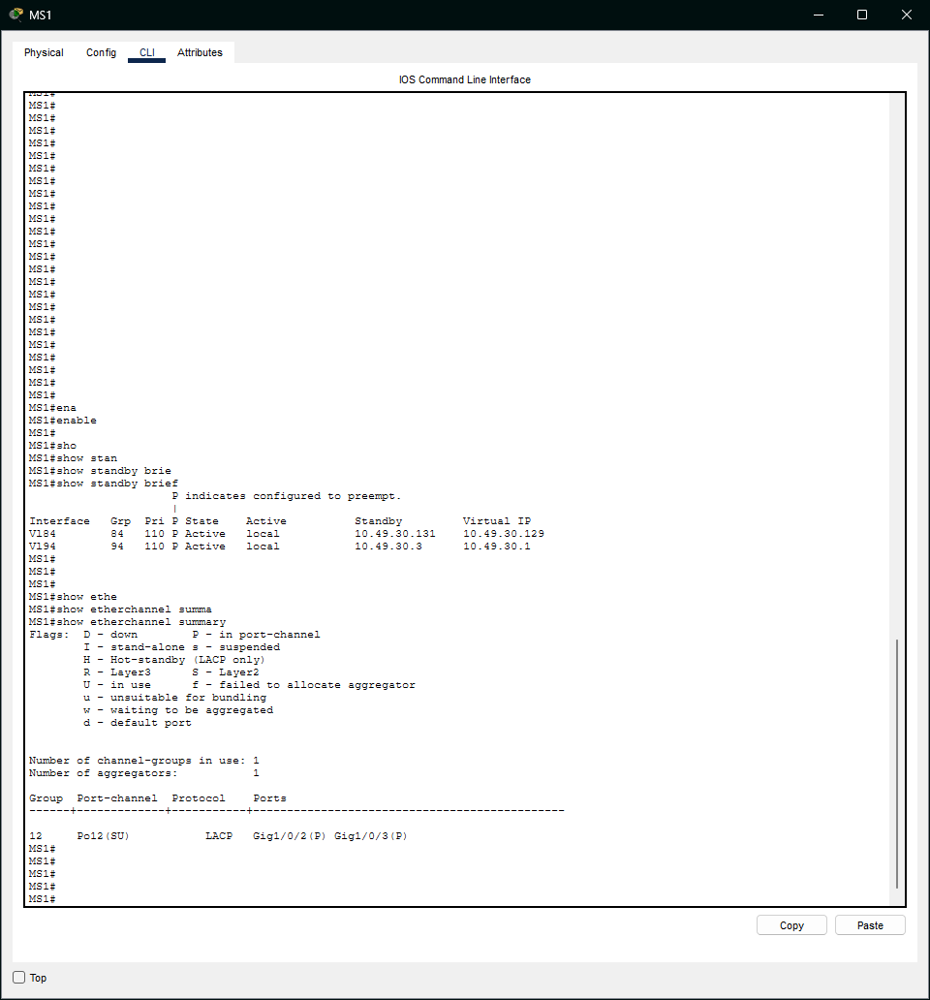
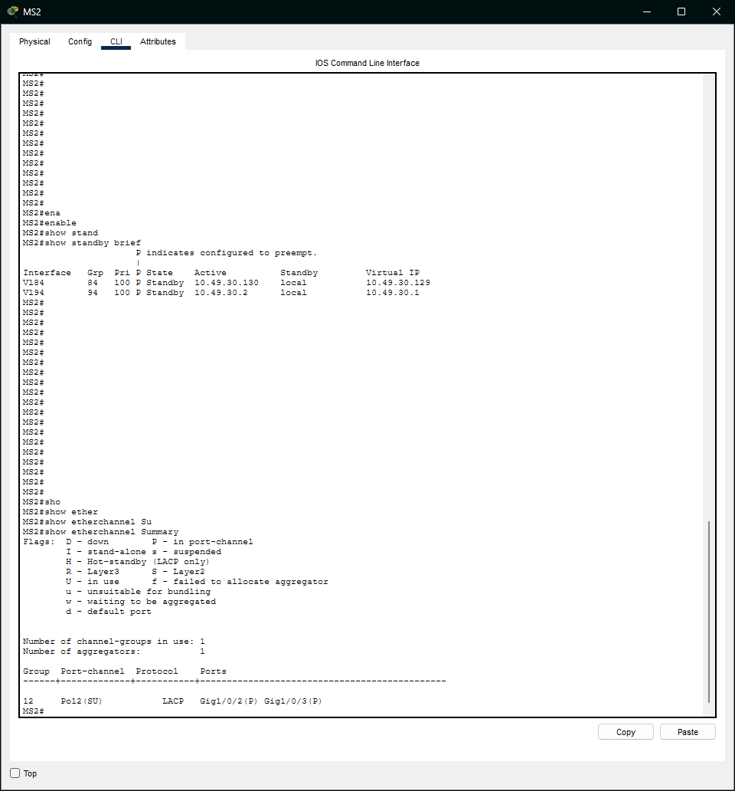

# BanTech GT

**Manual técnico · Infraestructura financiera**

Universidad de San Carlos de Guatemala · Facultad de Ingeniería · Escuela de Ciencias y Sistemas

| Curso | Proyecto | Período | Grupo |
|---|---|---|:---:|
| Redes de Computadoras 1 | Proyecto 2 | Segundo semestre de 2026 | 4 |

Este manual describe la infraestructura unificada de BanTech GT: backbone nacional, sedes Occidente, Norte y Oriente, y Data Center con Sede Central. Incluye el diseño físico y lógico, el direccionamiento, las configuraciones relevantes y las pruebas de conectividad y alta disponibilidad.

**Entrega:** [maestro final](Unido/BanTech_GT_v1.pkt) · [verificación final](Unido/VERIFICACION_FINAL.md) · [registro histórico de revisión](Unido/VALIDACION.md).

## Contenido

| Identificación y diseño | Implementación por sede | Validación y entrega |
|---|---|---|
| [1. Integrantes](#1-integrantes) | [7. Occidente](#7-sede-occidente-agencia-regional-comercial) | [11. Pruebas y alta disponibilidad](#11-pruebas-de-conectividad-y-alta-disponibilidad) |
| [2. Parámetros](#2-parámetros-de-identificación) | [8. Norte](#8-sede-norte-centro-de-autorización-de-créditos) | [12. Estructura del repositorio](#12-estructura-del-repositorio) |
| [3. Topología general](#3-topología-general) | [9. Oriente](#9-sede-oriente-centro-financiero-legado) | [Verificación final](Unido/VERIFICACION_FINAL.md) |
| [4. Backbone](#4-backbone-core) | [10. Data Center y Central](#10-data-center-y-sede-central) | [Registro histórico](Unido/VALIDACION.md) |
| [5. Direccionamiento](#5-plan-de-direccionamiento) | | |
| [6. VLANs](#6-tabla-de-vlans) | | |

---

## 1. Integrantes

| Nombre | Carné | Rol en el proyecto |
|---|---|---|
| Mariano Roberto Rac Noguera | 202101149 | Coordinador, backbone, Data Center y Sede Central |
| Oscar Vladimir Nij Cruz | 202100076 | Sede Occidente y Sede Norte |
| Luis Pablo Carlos Tapia | 202203257 | Sede Oriente, integración de la simulación y del manual |

## 2. Parámetros de identificación

El enunciado liga los parámetros de red al carné del coordinador y al número de grupo. El coordinador es Mariano (carné 202101149), por lo que XX = 49. El mismo valor se usa como segundo octeto de todo el direccionamiento, de modo que cada dirección del proyecto queda amarrada a la regla de identificación.

| Parámetro | Valor | Uso |
|---|---|---|
| XX | 49 | Dominio VTP `bantech49` y segundo octeto de la red `10.49.0.0/16` |
| Y | 4 | Grupo 4. Forma los IDs de VLAN (1Y, 2Y, 1Y+1, etc.) |
| Contraseña VTP | cisco | Sede Occidente |

Los IDs de VLAN se forman concatenando el número con Y. Con Y = 4, la VLAN 1Y es la 14 y la VLAN 1Y+1 es la 15.

## 3. Topología general

El **archivo maestro final** es [Unido/BanTech_GT_v1.pkt](Unido/BanTech_GT_v1.pkt). La [copia de prueba con el uplink de MS1 apagado](Unido/Prueba_HSRP_uplink_MS1_caido.pkt) conserva el escenario de conmutación corregido. Las copias de `Luis/`, `Mariano/` y `Oscar/` son históricas o parciales y no sustituyen al maestro de `Unido/`.

Última corrección y pruebas: 23 de octubre de 2026. [Resultados, extractos de consola y procedimiento de reproducción](Unido/VERIFICACION_FINAL.md).

La red revisada en Packet Tracer 9.0.1 contiene 112 dispositivos y 120 enlaces. El chequeo de salud no detectó enlaces caídos ni direcciones IP duplicadas.



Las cuatro sedes y el backbone están delimitados por dominio de enrutamiento. El fondo editable se conserva en [Unido/fondo_final.svg](Unido/fondo_final.svg). `Images/Maestro.png` es una captura histórica anterior al ordenamiento final.

La red se divide en un backbone nacional y cuatro redes de borde. El backbone es un núcleo de tres switches de capa 3 que corre OSPF y sirve de punto de encuentro de todos los dominios de enrutamiento. Cada sede se conecta al núcleo por medio de su propio equipo de borde, y cada una pertenece a uno de los cuatro métodos de enrutamiento exigidos.

| Sede | Dominio de enrutamiento | Equipo de borde | Se conecta a |
|---|---|---|---|
| Occidente | EIGRP 10 | R-Occidente | R-WAN (serial) |
| Norte | OSPF área 0 | R-Norte | CORE-2 |
| Oriente | RIPv2 | MS1 y MS2 | CORE-3 |
| Data Center y Central | Rutas estáticas | R-CENTRAL2 | R-CENTRAL1, que se conecta a CORE-1 |

## 4. Backbone Core


### 4.1 Justificación del diseño

El núcleo está formado por tres switches multicapa Cisco 3650 conectados en triángulo. El triángulo es la forma mínima en la que cualquier enlace o cualquier equipo del núcleo puede fallar sin partir la red, porque entre dos switches siempre queda un camino alterno a través del tercero. Cada lado del triángulo es un EtherChannel de capa 3 de dos enlaces de fibra negociado con LACP. Así el canal principal de tráfico transaccional suma el ancho de banda de dos enlaces y sobrevive a la caída de uno de ellos sin reconvergencia del protocolo de enrutamiento.

Se eligió EtherChannel de capa 3 (puertos ruteados, sin `switchport`) en lugar de troncales con SVIs porque en un núcleo enrutado cada enlace queda como una red punto a punto independiente. Eso elimina Spanning Tree del núcleo, hace que la redundancia la resuelva OSPF por costo y deja un direccionamiento /30 limpio por enlace.

OSPF es el protocolo del núcleo porque es un estándar abierto, converge rápido y escala por áreas si el banco sigue creciendo. Los otros dominios se colocaron según el papel de cada sede en el negocio. Occidente usa EIGRP porque representa la expansión regional y llega al núcleo por un enlace serial WAN, que es donde EIGRP aprovecha mejor su métrica basada en ancho de banda y retardo. Oriente usa RIPv2 porque es la red del banco recién adquirido, y RIPv2 representa la red legada que se integra sin rediseñarla. Norte habla OSPF directamente con el núcleo porque el centro de autorización de créditos es crítico y conviene que no dependa de ningún punto de redistribución. El Data Center queda en un segmento de rutas estáticas por la política de aislamiento del enunciado.

La redistribución se concentra en un solo equipo por cada par de dominios. Tener un único punto entre dos protocolos evita bucles de redistribución y vuelve predecible el camino de cada ruta. Por esa misma razón MS1 y MS2 suben ambos a CORE-3, que es el único equipo que traduce entre OSPF y RIPv2.

### 4.2 Equipos del backbone

| Equipo | Modelo | Función | Protocolos | Router ID |
|---|---|---|---|---|
| CORE-1 | 3650-24PS | Núcleo, enlace hacia Sede Central | OSPF | 1.1.1.1 |
| CORE-2 | 3650-24PS | Núcleo, agrega WAN y Norte | OSPF | 2.2.2.2 |
| CORE-3 | 3650-24PS | Núcleo y punto de redistribución hacia la red legada | OSPF, RIPv2 y agregado estático de respaldo | 3.3.3.3 |
| R-WAN | 2911 con HWIC-2T | Borde WAN y punto de redistribución hacia la expansión regional | OSPF y EIGRP 10 | 4.4.4.4 |
| R-CENTRAL1 | 2911 | Punto de redistribución del segmento estático | OSPF y estáticas | 5.5.5.5 |
| R-CENTRAL2 | 2911 | Router de acceso del Data Center | Estáticas | No aplica |

La infraestructura de red comprende 24 equipos: seis switches multicapa 3650-24PS, cinco routers 2911 y trece switches de acceso 2960-24TT. Los equipos finales son 70 PCs y 14 servidores, distribuidos en 12 VLANs de usuarios y servicios. El inventario incluye además cuatro dispositivos de distribución de energía.

### 4.3 Medios físicos y cableado

| Medio | Dónde se usa | Motivo |
|---|---|---|
| Fibra óptica | Los tres EtherChannel del núcleo (módulos GLC-LH-SMD en Gi1/1/1 a Gi1/1/4) | Mayor ancho de banda y distancia en el canal transaccional |
| Ethernet de cobre | Enlaces del núcleo hacia los equipos de borde | Interconexión local dentro del mismo sitio |
| Serial | R-WAN hacia R-Occidente | Representa la conexión WAN hacia la región |

Los cuatro 3650 (CORE-1, CORE-2, CORE-3 y MS-DC) necesitan el módulo AC-POWER-SUPPLY para encender. R-WAN y R-Occidente llevan un módulo HWIC-2T para el enlace serial. En R-WAN el HWIC-2T está en la ranura 3, por eso su puerto serial es Se0/3/0.

| Equipo A | Puerto A | Equipo B | Puerto B | Cable | Agrupación |
|---|---|---|---|---|---|
| CORE-1 | Gi1/1/1 | CORE-2 | Gi1/1/1 | Fibra | Po12 |
| CORE-1 | Gi1/1/2 | CORE-2 | Gi1/1/2 | Fibra | Po12 |
| CORE-1 | Gi1/1/3 | CORE-3 | Gi1/1/1 | Fibra | Po13 |
| CORE-1 | Gi1/1/4 | CORE-3 | Gi1/1/2 | Fibra | Po13 |
| CORE-2 | Gi1/1/3 | CORE-3 | Gi1/1/3 | Fibra | Po23 |
| CORE-2 | Gi1/1/4 | CORE-3 | Gi1/1/4 | Fibra | Po23 |
| CORE-1 | Gi1/0/1 | R-CENTRAL1 | Gi0/0 | Cobre directo | |
| CORE-2 | Gi1/0/1 | R-WAN | Gi0/0 | Cobre directo | |
| CORE-2 | Gi1/0/2 | R-Norte | Gi0/0 | Cobre directo | Integrado |
| CORE-3 | Gi1/0/1 | MS1 | Gi1/0/1 | Cobre directo | Integrado |
| CORE-3 | Gi1/0/2 | MS2 | Gi1/0/1 | Cobre directo | Integrado |
| R-WAN | Se0/3/0 (DCE) | R-Occidente | Se0/3/0 (DTE) | Serial DCE | Integrado |

### 4.4 Tabla de direcciones del backbone

Todo el backbone usa el bloque `10.49.0.0/24` dividido en subredes /30, una por enlace punto a punto. Se ocupan las primeras diez subredes y el resto queda libre para crecimiento.

| # | Enlace | Medio | Red | Extremo A | IP A | Extremo B | IP B |
|---|---|---|---|---|---|---|---|
| 1 | Po12 | Fibra, EtherChannel | 10.49.0.0/30 | CORE-1 Gi1/1/1-2 | 10.49.0.1 | CORE-2 Gi1/1/1-2 | 10.49.0.2 |
| 2 | Po13 | Fibra, EtherChannel | 10.49.0.4/30 | CORE-1 Gi1/1/3-4 | 10.49.0.5 | CORE-3 Gi1/1/1-2 | 10.49.0.6 |
| 3 | Po23 | Fibra, EtherChannel | 10.49.0.8/30 | CORE-2 Gi1/1/3-4 | 10.49.0.9 | CORE-3 Gi1/1/3-4 | 10.49.0.10 |
| 4 | CORE-1 a R-CENTRAL1 | Cobre | 10.49.0.12/30 | CORE-1 Gi1/0/1 | 10.49.0.13 | R-CENTRAL1 Gi0/0 | 10.49.0.14 |
| 5 | R-CENTRAL1 a R-CENTRAL2 | Cobre | 10.49.0.16/30 | R-CENTRAL1 Gi0/1 | 10.49.0.17 | R-CENTRAL2 Gi0/0 | 10.49.0.18 |
| 6 | CORE-2 a R-WAN | Cobre | 10.49.0.20/30 | CORE-2 Gi1/0/1 | 10.49.0.21 | R-WAN Gi0/0 | 10.49.0.22 |
| 7 | R-WAN a R-Occidente | Serial | 10.49.0.24/30 | R-WAN Se0/3/0 (DCE) | 10.49.0.25 | R-Occidente Se0/3/0 (DTE) | 10.49.0.26 |
| 8 | CORE-2 a R-Norte | Cobre | 10.49.0.28/30 | CORE-2 Gi1/0/2 | 10.49.0.29 | R-Norte Gi0/0 | 10.49.0.30 |
| 9 | CORE-3 a MS1 | Cobre | 10.49.0.32/30 | CORE-3 Gi1/0/1 | 10.49.0.33 | MS1 Gi1/0/1 | 10.49.0.34 |
| 10 | CORE-3 a MS2 | Cobre | 10.49.0.36/30 | CORE-3 Gi1/0/2 | 10.49.0.37 | MS2 Gi1/0/1 | 10.49.0.38 |

Las interfaces de los switches del núcleo hacia los equipos de borde se configuran como puertos ruteados (`no switchport`). En el enlace serial, R-WAN es el extremo DCE y lleva el `clock rate`.

### 4.5 Puntos de redistribución

| Equipo | Dominios | Qué propaga |
|---|---|---|
| R-WAN | OSPF y EIGRP 10 | Redistribución mutua. Occidente aprende el resto de la red y el núcleo aprende las redes de Occidente |
| CORE-3 | OSPF y RIPv2 | Redistribución mutua. Oriente aprende el resto de la red y el núcleo aprende las redes de Oriente |
| R-CENTRAL1 | Estáticas hacia OSPF | Propaga la ruta estática del Data Center al núcleo sin exponer el segmento estático |

CORE-3 conserva además el agregado de respaldo `10.49.30.0/24`: vía MS2 (`10.49.0.38`, distancia 250) y una ruta estática flotante del mismo agregado vía MS1 (`10.49.0.34`, distancia 251). Se redistribuye en OSPF junto con RIP. Las rutas RIP `/25` y `/26` son más específicas y siguen siendo preferidas para las VLANs; la distancia administrativa no se compara entre prefijos de distinta longitud. El `/24` es un resumen de rutas, no una nueva subred asignada ni un cambio de las máscaras de los hosts.

En Packet Tracer 9.0.1 se observó que retirar un miembro del ECMP RIP podía retirar el anuncio OSPF de las redes específicas aunque CORE-3 conservara el otro siguiente salto RIP. El agregado mantiene una ruta de retorno durante ese escenario. Si cae el enlace a MS2, el agregado usa la alternativa de distancia 251 por MS1. Se verificaron ambas fallas por separado, con resultados en la [verificación final](Unido/VERIFICACION_FINAL.md).

Cada protocolo necesita un dato distinto al recibir rutas externas. OSPF requiere la palabra `subnets` para redistribuir redes con máscara distinta a la de su clase, y como todas las redes del proyecto son subredes de 10.0.0.0/8, sin ella no se redistribuiría ninguna. EIGRP y RIP requieren una métrica explícita, porque no saben traducir el costo de OSPF y sin ella anuncian las rutas como inalcanzables. En EIGRP, la configuración real `1544 200 255 1 1500` corresponde a ancho de banda en kbps, retardo en decenas de microsegundos, confiabilidad, carga y MTU. En RIP, `metric 2` asigna dos saltos y deja margen bajo el límite de 15.

```
! R-WAN
interface Serial0/3/0
 ip address 10.49.0.25 255.255.255.252
 clock rate 64000
router ospf 1
 router-id 4.4.4.4
 network 10.49.0.20 0.0.0.3 area 0
 redistribute eigrp 10 subnets
router eigrp 10
 network 10.49.0.24 0.0.0.3
 no auto-summary
  redistribute ospf 1 metric 1544 200 255 1 1500
!
! CORE-3
ip route 10.49.30.0 255.255.255.0 10.49.0.38 250
ip route 10.49.30.0 255.255.255.0 10.49.0.34 251
router ospf 1
 router-id 3.3.3.3
 network 10.49.0.4 0.0.0.3 area 0
 network 10.49.0.8 0.0.0.3 area 0
  redistribute rip subnets
  redistribute static subnets
router rip
 version 2
 no auto-summary
 network 10.0.0.0
 redistribute ospf 1 metric 2
!
! R-CENTRAL1
ip route 10.49.40.0 255.255.255.0 10.49.0.18
router ospf 1
 router-id 5.5.5.5
 network 10.49.0.12 0.0.0.3 area 0
 network 10.49.0.16 0.0.0.3 area 0
 passive-interface GigabitEthernet0/1
 redistribute static subnets
```

En R-CENTRAL1, `passive-interface GigabitEthernet0/1` anuncia el enlace hacia R-CENTRAL2 en OSPF pero no envía hellos por él, de modo que ningún protocolo dinámico entra al segmento de alta seguridad.

### 4.6 Vecinos OSPF y tabla de enrutamiento del núcleo


En CORE-1 los tres vecinos OSPF (2.2.2.2, 3.3.3.3 y 5.5.5.5) están en FULL. La red 10.49.0.8/30 aparece por dos caminos de costo igual (vía CORE-2 y vía CORE-3), y la ruta `O E2 10.49.40.0 [110/20]` aprendida de R-CENTRAL1 prueba que la ruta estática del Data Center se redistribuye hacia OSPF.

Los EtherChannel del núcleo operan en capa 3: el estado esperado en `show etherchannel summary` es `RU`, con sus puertos miembros en `P`. En el Data Center y en Oriente los canales son de capa 2 y su estado es `SU`.

### 4.7 Enlaces entre el backbone y las sedes

Cuatro enlaces conectan los equipos de borde de Occidente, Norte y Oriente con el backbone. Norte forma parte del área OSPF del núcleo; Occidente y Oriente se comunican con ella mediante redistribución en sus respectivos equipos frontera.

| Enlace | Extremo backbone (Mariano) | Extremo de la sede | Responsable de la sede | Red | Protocolo en ambos extremos |
|---|---|---|---|---|---|
| CORE-2 a R-Norte | CORE-2 Gi1/0/2, 10.49.0.29 | R-Norte Gi0/0, 10.49.0.30 | Oscar | 10.49.0.28/30 | OSPF 1, área 0 |
| R-WAN a R-Occidente | R-WAN Se0/3/0 (DCE, clock rate 64000), 10.49.0.25 | R-Occidente Se0/3/0 (DTE), 10.49.0.26 | Oscar | 10.49.0.24/30 | EIGRP 10 |
| CORE-3 a MS1 | CORE-3 Gi1/0/1, 10.49.0.33 | MS1 Gi1/0/1 (puerto ruteado), 10.49.0.34 | Luis | 10.49.0.32/30 | RIPv2, sin auto-summary |
| CORE-3 a MS2 | CORE-3 Gi1/0/2, 10.49.0.37 | MS2 Gi1/0/1 (puerto ruteado), 10.49.0.38 | Luis | 10.49.0.36/30 | RIPv2, sin auto-summary |

R-Occidente y R-WAN utilizan HWIC-2T en la ranura 0/3. En Oriente, MS1 y MS2 tienen `ip routing` habilitado y Gi1/0/1 como puerto ruteado. Las interfaces físicas de los routers hacia los troncales de usuarios no necesitan una IP propia: las direcciones de gateway están en las subinterfaces 802.1Q.

### 4.8 Configuración de los canales del núcleo

```ios
! CORE-1
ip routing
interface range GigabitEthernet1/1/1 - 2
 no switchport
 channel-group 12 mode active
interface Port-channel12
 no switchport
 ip address 10.49.0.1 255.255.255.252
interface range GigabitEthernet1/1/3 - 4
 no switchport
 channel-group 13 mode active
interface Port-channel13
 no switchport
 ip address 10.49.0.5 255.255.255.252
interface GigabitEthernet1/0/1
 no switchport
 ip address 10.49.0.13 255.255.255.252
router ospf 1
 router-id 1.1.1.1
 network 10.49.0.0 0.0.0.3 area 0
 network 10.49.0.4 0.0.0.3 area 0
 network 10.49.0.12 0.0.0.3 area 0
```

CORE-2 utiliza el mismo patrón de puertos ruteados y LACP para Po12 y Po23; CORE-3 lo utiliza para Po13 y Po23. Las IPs de sus canales son las de la tabla 4.4. Los anuncios OSPF se distribuyen así:

| Equipo | Redes OSPF, todas en área 0 |
|---|---|
| CORE-1 | 10.49.0.0/30, 10.49.0.4/30, 10.49.0.12/30 |
| CORE-2 | 10.49.0.0/30, 10.49.0.8/30, 10.49.0.20/30, 10.49.0.28/30 |
| CORE-3 | 10.49.0.4/30, 10.49.0.8/30; redistribución de RIP |
| R-WAN | 10.49.0.20/30; redistribución de EIGRP 10 |
| R-CENTRAL1 | 10.49.0.12/30, 10.49.0.16/30; redistribución de estáticas |
| R-Norte | 10.49.0.28/30, 10.49.20.0/26, 10.49.20.64/27, 10.49.20.96/27 |

## 5. Plan de direccionamiento

### 5.1 Bloques por sede

Cada sede tiene reservado un /24 dentro de `10.49.0.0/16`. El VLSM dimensiona las VLANs según su capacidad y mantiene separados los bloques de las sedes.

| Bloque | Uso |
|---|---|
| 10.49.0.0/24 | Enlaces punto a punto del backbone |
| 10.49.10.0/24 | Sede Occidente |
| 10.49.20.0/24 | Sede Norte |
| 10.49.30.0/24 | Sede Oriente |
| 10.49.40.0/24 | Data Center y Sede Central |

### 5.2 Subneteo VLSM

En cada subred se reserva una dirección para el gateway además de los hosts requeridos. En Oriente se reservan tres, porque HSRP usa la IP virtual más una IP real en MS1 y otra en MS2. Por eso Asesores (30 hosts), Legal y Core_BD (14 hosts) y Plataforma (60 hosts) suben a la siguiente máscara.

| Sede | VLAN | Hosts requeridos | Red | Máscara | Gateway | Rango asignable | Broadcast |
|---|---|---|---|---|---|---|---|
| Occidente | Cajas | 45 | 10.49.10.0 | /26 | 10.49.10.1 | .2 a .62 | 10.49.10.63 |
| Occidente | Asesores | 30 | 10.49.10.64 | /26 | 10.49.10.65 | .66 a .126 | 10.49.10.127 |
| Occidente | Seguridad | 12 | 10.49.10.128 | /28 | 10.49.10.129 | .130 a .142 | 10.49.10.143 |
| Occidente | Gerencia | 10 | 10.49.10.144 | /28 | 10.49.10.145 | .146 a .158 | 10.49.10.159 |
| Norte | Análisis | 50 | 10.49.20.0 | /26 | 10.49.20.1 | .2 a .62 | 10.49.20.63 |
| Norte | Auditoría | 25 | 10.49.20.64 | /27 | 10.49.20.65 | .66 a .94 | 10.49.20.95 |
| Norte | Legal | 14 | 10.49.20.96 | /27 | 10.49.20.97 | .98 a .126 | 10.49.20.127 |
| Oriente | Plataforma | 60 | 10.49.30.0 | /25 | 10.49.30.1 (virtual) | .4 a .126 | 10.49.30.127 |
| Oriente | Bóveda | 40 | 10.49.30.128 | /26 | 10.49.30.129 (virtual) | .132 a .190 | 10.49.30.191 |
| Central | Web_Apps | 28 | 10.49.40.0 | /27 | 10.49.40.1 | .2 a .30 | 10.49.40.31 |
| Central | Core_BD | 14 | 10.49.40.32 | /27 | 10.49.40.33 | .34 a .62 | 10.49.40.63 |
| Central | NOC | 10 | 10.49.40.64 | /28 | 10.49.40.65 | .66 a .78 | 10.49.40.79 |
| Central | Enlace R-CENTRAL2 a MS-DC | 2 | 10.49.40.80 | /30 | | .81 y .82 | 10.49.40.83 |

En Oriente, MS1 usa .2 y MS2 usa .3 en Plataforma, y MS1 usa .130 y MS2 usa .131 en Bóveda.

Las subredes no se traslapan y reservan capacidad para los hosts requeridos, además de las direcciones de gateway. En la simulación se representan siete equipos finales por VLAN.

### 5.3 Direccionamiento de equipos finales por sede

| Sede | Equipos | VLAN | IPs configuradas | Máscara | Gateway |
|---|---|---|---|---|---|
| Occidente | PC0–PC6, Cajas | 14 | 10.49.10.2–10.49.10.8 | 255.255.255.192 | 10.49.10.1 |
| Occidente | PC7–PC13, Asesores | 24 | 10.49.10.66–10.49.10.72 | 255.255.255.192 | 10.49.10.65 |
| Occidente | PC14–PC20, Gerencia | 34 | 10.49.10.146–10.49.10.152 | 255.255.255.240 | 10.49.10.145 |
| Occidente | PC21–PC27, Seguridad | 44 | 10.49.10.130–10.49.10.136 | 255.255.255.240 | 10.49.10.129 |
| Norte | PC-A1–PC-A7, Análisis | 54 | 10.49.20.2–10.49.20.8 | 255.255.255.192 | 10.49.20.1 |
| Norte | PC-U1–PC-U7, Auditoría | 64 | 10.49.20.66–10.49.20.72 | 255.255.255.224 | 10.49.20.65 |
| Norte | PC-L1–PC-L7, Legal | 74 | 10.49.20.98–10.49.20.104 | 255.255.255.224 | 10.49.20.97 |
| Oriente | PLAT1–PLAT7, Plataforma | 94 | 10.49.30.4–10.49.30.10 | 255.255.255.128 | 10.49.30.1 |
| Oriente | BOV1–BOV7, Bóveda | 84 | 10.49.30.132–10.49.30.138 | 255.255.255.192 | 10.49.30.129 |
| Central | BD1–BD7, Core_BD | 15 | 10.49.40.34–10.49.40.40 | 255.255.255.224 | 10.49.40.33 |
| Central | WEB1–WEB7, Web_Apps | 25 | 10.49.40.2–10.49.40.8 | 255.255.255.224 | 10.49.40.1 |
| Central | NOC1–NOC7 | 35 | 10.49.40.66–10.49.40.72 | 255.255.255.240 | 10.49.40.65 |

Las direcciones aumentan de forma consecutiva según el número de equipo dentro de cada grupo.

## 6. Tabla de VLANs

Los IDs se forman con Y = 4. Los nombres van sin tilde para evitar problemas en IOS.

| ID | Fórmula | Nombre | Sede | Red |
|---|---|---|---|---|
| 14 | 1Y | Cajas | Occidente | 10.49.10.0/26 |
| 24 | 2Y | Asesores | Occidente | 10.49.10.64/26 |
| 34 | 3Y | Gerencia | Occidente | 10.49.10.144/28 |
| 44 | 4Y | Seguridad | Occidente | 10.49.10.128/28 |
| 54 | 5Y | Analisis | Norte | 10.49.20.0/26 |
| 64 | 6Y | Auditoria | Norte | 10.49.20.64/27 |
| 74 | 7Y | Legal | Norte | 10.49.20.96/27 |
| 84 | 8Y | Boveda | Oriente | 10.49.30.128/26 |
| 94 | 9Y | Plataforma | Oriente | 10.49.30.0/25 |
| 15 | 1Y+1 | Core_BD | Central | 10.49.40.32/27 |
| 25 | 2Y+1 | Web_Apps | Central | 10.49.40.0/27 |
| 35 | 3Y+1 | NOC | Central | 10.49.40.64/28 |

## 7. Sede Occidente, Agencia Regional Comercial



### 7.1 Justificación de la arquitectura

Occidente usa una estrella con un switch principal y cuatro switches de acceso, uno por departamento. Las VLANs separan los dominios de broadcast de Cajas, Asesores, Gerencia y Seguridad: una falla de acceso en Asesores no desconecta físicamente a Cajas. R-Occidente realiza el enrutamiento inter-VLAN mediante subinterfaces 802.1Q y anuncia las redes mediante EIGRP 10 hacia R-WAN. El switch principal y el router siguen siendo puntos comunes de falla; la segmentación no implica redundancia de esos equipos ni filtrado del tráfico inter-VLAN.

### 7.2 Mapeo lógico

| Equipo | Función | Enlaces troncales 802.1Q | Puertos de acceso |
|---|---|---|---|
| R-Occidente | Router de borde, Router-on-a-Stick y EIGRP 10 | Gi0/0 con subinterfaces .14, .24, .34 y .44 | Ninguno; Se0/3/0 hacia R-WAN |
| SW-O-PRINCIPAL | Distribución, VTP servidor | Gi0/1 al router; Fa0/1 a Cajas, Fa0/2 a Asesores, Fa0/3 a Gerencia, Fa0/4 a Seguridad; VLANs 14,24,34,44 | Ninguno de usuarios |
| SW-O-CAJAS | Acceso, VTP cliente | Fa0/24 hacia SW-O-PRINCIPAL | Fa0/1-7, VLAN 14, PC0-6 |
| SW-O-ASESORES | Acceso, VTP cliente | Fa0/24 hacia SW-O-PRINCIPAL | Fa0/1-7, VLAN 24, PC7-13 |
| SW-O-GERENCIA | Acceso, VTP cliente | Fa0/24 hacia SW-O-PRINCIPAL | Fa0/1-7, VLAN 34, PC14-20 |
| SW-O-SEGURIDAD | Acceso, VTP cliente | Fa0/24 hacia SW-O-PRINCIPAL | Fa0/1-7, VLAN 44, PC21-27 |

Las [conexiones físicas](Oscar/capturas/02_Conexiones_Fisicas_Occidente.jpeg) muestran la estrella de acceso. Las [troncales de distribución](Oscar/capturas/05_Trunks_Principal_Occidente.jpeg) transportan las VLANs 14,24,34,44.

VTP versión 2 utiliza el dominio `bantech49` y la contraseña `cisco`. SW-O-PRINCIPAL opera como servidor y los cuatro switches de acceso como clientes. Las sedes se conectan por capa 3: las bases VTP de Occidente y Norte permanecen separadas aunque comparten nombre de dominio.

### 7.3 Extractos de configuración

```ios
! SW-O-PRINCIPAL; los switches de acceso usan vtp mode client
vtp version 2
vtp domain bantech49
vtp password cisco
vtp mode server
vlan 14
 name CAJAS
vlan 24
 name ASESORES
vlan 34
 name GERENCIA
vlan 44
 name SEGURIDAD
! R-Occidente
interface GigabitEthernet0/0.14
 encapsulation dot1Q 14
 ip address 10.49.10.1 255.255.255.192
interface GigabitEthernet0/0.24
 encapsulation dot1Q 24
 ip address 10.49.10.65 255.255.255.192
interface GigabitEthernet0/0.34
 encapsulation dot1Q 34
 ip address 10.49.10.145 255.255.255.240
interface GigabitEthernet0/0.44
 encapsulation dot1Q 44
 ip address 10.49.10.129 255.255.255.240
interface Serial0/3/0
 ip address 10.49.0.26 255.255.255.252
router eigrp 10
 network 10.49.0.24 0.0.0.3
 network 10.49.10.0 0.0.0.63
 network 10.49.10.64 0.0.0.63
 network 10.49.10.128 0.0.0.15
 network 10.49.10.144 0.0.0.15
 passive-interface GigabitEthernet0/0.14
 passive-interface GigabitEthernet0/0.24
 passive-interface GigabitEthernet0/0.34
 passive-interface GigabitEthernet0/0.44
 no auto-summary
```

Las subinterfaces pasivas anuncian sus redes sin enviar actualizaciones EIGRP a los equipos finales. Evidencias: [VTP](Oscar/capturas/03_VTP_Server_Occidente.jpeg), [subinterfaces](Oscar/capturas/16_Subinterfaces_ROAS_Occidente.jpeg) y [EIGRP](Oscar/capturas/32_EIGRP_Protocolos_Occidente.jpeg).

## 8. Sede Norte, Centro de Autorización de Créditos

Las troncales de Norte se muestran en esta [captura de SW-N-PRINCIPAL](Oscar/capturas/35_Trunks_SW_N_Principal.jpeg).

### 8.1 Justificación de la arquitectura

Norte combina enlaces directos al switch principal con enlaces redundantes entre switches de acceso. Rapid PVST+ bloquea caminos alternativos para evitar bucles y los habilita tras una falla. SW-N-PRINCIPAL es la raíz de las VLANs 54, 64 y 74 porque concentra los enlaces hacia R-Norte. Así, la pérdida del enlace directo de Análisis al principal puede resolverse por otro switch de acceso. El router y el switch principal siguen siendo puntos comunes de salida.

### 8.2 Mapeo lógico

| Equipo | Función | Enlaces troncales 802.1Q | Puertos de acceso |
|---|---|---|---|
| R-Norte | Router de borde, Router-on-a-Stick y OSPF | Gi0/1 con subinterfaces .54, .64 y .74 | Ninguno; Gi0/0 hacia CORE-2 |
| SW-N-PRINCIPAL | Distribución, Root Bridge | Fa0/1 a Análisis, Fa0/2 a Auditoría, Fa0/3 a Legal, Gi0/1 a R-Norte; VLANs 54,64,74 | Ninguno de usuarios |
| SW-N-ANALISIS | Acceso con caminos redundantes | Hacia principal y switches de acceso | Fa0/1-7, VLAN 54 |
| SW-N-AUDITORIA | Acceso con caminos redundantes | Hacia principal y switches de acceso | Fa0/1-7, VLAN 64 |
| SW-N-LEGAL | Acceso con caminos redundantes | Hacia principal y switches de acceso | Fa0/1-7, VLAN 74 |

Los cuatro switches utilizan Rapid PVST+. SW-N-PRINCIPAL opera como servidor VTP y los switches de acceso como clientes, con dominio `bantech49`, versión 2 y contraseña `cisco`. Las troncales permiten las VLANs 54,64,74. La prioridad base de la raíz es 24576; el identificador extendido suma el ID de VLAN.

### 8.3 Extractos de configuración

```ios
! SW-N-PRINCIPAL; Rapid PVST+ también en los switches de acceso
spanning-tree mode rapid-pvst
spanning-tree vlan 54,64,74 root primary
vlan 54
 name ANALISIS
vlan 64
 name AUDITORIA
vlan 74
 name LEGAL
! R-Norte
interface GigabitEthernet0/0
 ip address 10.49.0.30 255.255.255.252
interface GigabitEthernet0/1.54
 encapsulation dot1Q 54
 ip address 10.49.20.1 255.255.255.192
interface GigabitEthernet0/1.64
 encapsulation dot1Q 64
 ip address 10.49.20.65 255.255.255.224
interface GigabitEthernet0/1.74
 encapsulation dot1Q 74
 ip address 10.49.20.97 255.255.255.224
router ospf 1
 router-id 10.49.0.30
 network 10.49.0.28 0.0.0.3 area 0
 network 10.49.20.0 0.0.0.63 area 0
 network 10.49.20.64 0.0.0.31 area 0
 network 10.49.20.96 0.0.0.31 area 0
 passive-interface GigabitEthernet0/1.54
 passive-interface GigabitEthernet0/1.64
 passive-interface GigabitEthernet0/1.74
```

Evidencias: [raíz VLAN 54](Oscar/capturas/36_Root_Bridge_VLAN54_Norte.jpeg), [raíz VLAN 64](Oscar/capturas/37_Root_Bridge_VLAN64_Norte.jpeg), [raíz VLAN 74](Oscar/capturas/38_Root_Bridge_VLAN74_Norte.jpeg) y [OSPF](Oscar/capturas/57_OSPF_Protocolos_R_Norte.jpeg). La prioridad observada para VLAN 54 fue 24630 (24576 + 54).

## 9. Sede Oriente, Centro Financiero Legado

Oriente contiene dos switches multicapa de distribución y dos switches de acceso. Sus 14 PCs se distribuyen entre Plataforma y Bóveda. Los dos equipos de distribución anuncian las redes de usuarios a CORE-3 mediante RIPv2.

### 9.1 Justificación de la arquitectura

MS1 y MS2 son switches multicapa 3650-24PS unidos por Po12, un EtherChannel troncal LACP de dos cables. Cada switch de acceso tiene una troncal a MS1 y otra a MS2, de modo que puede seguir llegando al gateway cuando falla uno de los equipos de distribución. HSRP conserva las IPs virtuales de ambas VLANs: MS1 es el activo preferido (prioridad 105) y MS2 el respaldo (100), con preempt. Ambos siguen Gi1/0/1 con decremento de 10: al perder su uplink, MS1 baja a 95 y MS2 asume el gateway. Rapid PVST+ evita los bucles; durante la falla de uplink el tráfico puede cruzar Po12 hasta el gateway activo en MS2. CORE-3 sigue siendo el punto común de salida hacia el backbone.

### 9.2 Mapeo lógico

| Equipo | Función | Enlaces troncales 802.1Q | Puertos de acceso |
|---|---|---|---|
| MS1 | Distribución, HSRP activo preferido; RIPv2 | Po12 (Gi1/0/2-3), Gi1/0/4-5; VLANs 84,94 | Ninguno; Gi1/0/1 ruteado hacia CORE-3 |
| MS2 | Distribución, HSRP en espera; RIPv2 | Po12 (Gi1/0/2-3), Gi1/0/4-5; VLANs 84,94 | Ninguno; Gi1/0/1 ruteado hacia CORE-3 |
| SW-E-ACC1 | Acceso de Plataforma | Gi0/1 a MS1, Gi0/2 a MS2; VLANs 84,94 | Fa0/1-7, VLAN 94, PLAT1-7 |
| SW-E-ACC2 | Acceso de Bóveda | Gi0/1 a MS1, Gi0/2 a MS2; VLANs 84,94 | Fa0/1-7, VLAN 84, BOV1-7 |

### 9.3 Extractos de configuración

Los cuatro switches usan VTP transparente. Configuraciones: [MS1](Luis/Config/MS1.conf), [MS2](Luis/Config/MS2.conf), [SW-E-ACC1](Luis/Config/SW-E-ACC1.conf) y [SW-E-ACC2](Luis/Config/SW-E-ACC2.conf). [Guía de aplicación y verificación](Luis/Config/README.md).

```ios
! MS1; MS2 usa .131 en Vlan84, .3 en Vlan94 y prioridad 100
ip routing
vtp mode transparent
interface GigabitEthernet1/0/1
 no switchport
 ip address 10.49.0.34 255.255.255.252
interface Port-channel12
 switchport mode trunk
 switchport trunk allowed vlan 84,94
interface range GigabitEthernet1/0/2 - 3
 switchport mode trunk
 switchport trunk allowed vlan 84,94
 channel-group 12 mode active
interface Vlan84
 ip address 10.49.30.130 255.255.255.192
 standby 84 ip 10.49.30.129
  standby 84 priority 105
  standby 84 preempt
  standby 84 track GigabitEthernet1/0/1
interface Vlan94
 ip address 10.49.30.2 255.255.255.128
 standby 94 ip 10.49.30.1
  standby 94 priority 105
  standby 94 preempt
  standby 94 track GigabitEthernet1/0/1
router rip
 version 2
 no auto-summary
 network 10.0.0.0
 passive-interface Vlan84
 passive-interface Vlan94
spanning-tree mode rapid-pvst
spanning-tree vlan 84,94 priority 24576
```

En MS2, Gi1/0/1 usa `10.49.0.38/30` y la prioridad STP es 28672. Los grupos HSRP 84 y 94 usan `preempt` y `track GigabitEthernet1/0/1` en ambos equipos. El simulador admite el decremento predeterminado de 10; la separación 105/100 garantiza que MS1 quede por debajo de MS2 al perder el uplink. Los puertos de acceso de los 2960 tienen PortFast y BPDU Guard.

### 9.4 Cableado e interfaces de Oriente

| Equipo A | Puerto A | Equipo B | Puerto B | Función |
|---|---|---|---|---|
| CORE-3 | Gi1/0/1 | MS1 | Gi1/0/1 | Enlace ruteado 10.49.0.32/30 |
| CORE-3 | Gi1/0/2 | MS2 | Gi1/0/1 | Enlace ruteado 10.49.0.36/30 |
| MS1 | Gi1/0/2-3 | MS2 | Gi1/0/2-3 | Po12, LACP, troncal 84,94 |
| MS1 | Gi1/0/4 | SW-E-ACC1 | Gi0/1 | Troncal 84,94 |
| MS2 | Gi1/0/4 | SW-E-ACC1 | Gi0/2 | Troncal 84,94 |
| MS1 | Gi1/0/5 | SW-E-ACC2 | Gi0/1 | Troncal 84,94 |
| MS2 | Gi1/0/5 | SW-E-ACC2 | Gi0/2 | Troncal 84,94 |
| SW-E-ACC1 | Fa0/1-7 | PLAT1-7 | Fa0 | Acceso VLAN 94 |
| SW-E-ACC2 | Fa0/1-7 | BOV1-7 | Fa0 | Acceso VLAN 84 |

| VLAN | Red | Gateway virtual | IP MS1 | IP MS2 |
|---|---|---|---|---|
| 84, Bóveda | 10.49.30.128/26 | 10.49.30.129 | 10.49.30.130 | 10.49.30.131 |
| 94, Plataforma | 10.49.30.0/25 | 10.49.30.1 | 10.49.30.2 | 10.49.30.3 |

### 9.5 Estado de redundancia y rutas

En estado estable, MS1 es Active y MS2 Standby en ambos grupos HSRP. Po12 aparece `SU`, con Gi1/0/2 y Gi1/0/3 en `P`. CORE-3 aprende las redes `10.49.30.0/25` y `10.49.30.128/26` por RIPv2 con métrica 1, a través de los siguientes saltos `10.49.0.34` y `10.49.0.38`.





## 10. Data Center y Sede Central


### 10.1 Justificación de la arquitectura

La sede usa dos routers con funciones separadas. R-CENTRAL2 es el router de acceso del Data Center y solo conoce rutas estáticas: una ruta por defecto hacia R-CENTRAL1 y tres rutas estáticas explícitas, una por cada VLAN de servidores (10.49.40.0/27, 10.49.40.32/27 y 10.49.40.64/28), a través de MS-DC. R-CENTRAL1 recibe el segmento con una sola ruta estática resumida (`10.49.40.0/24`) y la redistribuye en OSPF. De esta forma el resto de la red alcanza a los servidores sin que ningún protocolo dinámico entre al segmento de alta seguridad.

MS-DC es el switch de distribución de los servidores y hace el enrutamiento inter-VLAN con SVIs para Core_BD, Web_Apps y NOC. Hacia cada uno de los dos switches de acceso sube por un EtherChannel LACP de dos cables. Eso responde a la necesidad de sumar capacidad ante las ráfagas de tráfico y además tolera la caída de un cable sin cortar el servicio. SW-DC-ACC1 concentra los servidores de base de datos y de banca virtual, y SW-DC-ACC2 concentra los equipos de monitoreo del NOC, de modo que el tráfico de operación no compite con el de los servidores en el mismo canal.

### 10.2 Mapeo lógico

| Equipo | Función | Enlaces troncales 802.1Q | Puertos de acceso |
|---|---|---|---|
| R-CENTRAL1 | Redistribución del segmento estático hacia OSPF | Ninguno (puertos ruteados) | Ninguno |
| R-CENTRAL2 | Router de acceso del Data Center, rutas estáticas | Ninguno (puertos ruteados) | Ninguno |
| MS-DC | Switch principal de distribución e inter-VLAN | Po1 (Gi1/0/2-3) y Po2 (Gi1/0/4-5) | Ninguno |
| SW-DC-ACC1 | Acceso de servidores | Po1 (Gi0/1-2) | Fa0/1-7 VLAN 15 Core_BD, Fa0/8-14 VLAN 25 Web_Apps |
| SW-DC-ACC2 | Acceso del NOC | Po2 (Gi0/1-2) | Fa0/1-7 VLAN 35 NOC |

### 10.3 Cableado

| Equipo A | Puerto A | Equipo B | Puerto B | Cable | Agrupación |
|---|---|---|---|---|---|
| R-CENTRAL1 | Gi0/1 | R-CENTRAL2 | Gi0/0 | Cobre directo | |
| R-CENTRAL2 | Gi0/1 | MS-DC | Gi1/0/1 | Cobre directo | |
| MS-DC | Gi1/0/2 | SW-DC-ACC1 | Gi0/1 | Cobre directo | Po1 |
| MS-DC | Gi1/0/3 | SW-DC-ACC1 | Gi0/2 | Cobre directo | Po1 |
| MS-DC | Gi1/0/4 | SW-DC-ACC2 | Gi0/1 | Cobre directo | Po2 |
| MS-DC | Gi1/0/5 | SW-DC-ACC2 | Gi0/2 | Cobre directo | Po2 |
| SW-DC-ACC1 | Fa0/1 a Fa0/7 | BD1 a BD7 | Fa0 | Cobre directo | VLAN Core_BD |
| SW-DC-ACC1 | Fa0/8 a Fa0/14 | WEB1 a WEB7 | Fa0 | Cobre directo | VLAN Web_Apps |
| SW-DC-ACC2 | Fa0/1 a Fa0/7 | NOC1 a NOC7 | Fa0 | Cobre directo | VLAN NOC |

Cada equipo final va en el puerto con su mismo número. Por ejemplo, BD1 va en Fa0/1, BD7 en Fa0/7, WEB1 en Fa0/8 y WEB7 en Fa0/14.

### 10.4 Direccionamiento de interfaces

| Equipo | Interfaz | Dirección IP | Máscara | Descripción |
|---|---|---|---|---|
| R-CENTRAL1 | Gi0/0 | 10.49.0.14 | 255.255.255.252 | Hacia CORE-1 |
| R-CENTRAL1 | Gi0/1 | 10.49.0.17 | 255.255.255.252 | Hacia R-CENTRAL2 |
| R-CENTRAL2 | Gi0/0 | 10.49.0.18 | 255.255.255.252 | Hacia R-CENTRAL1 |
| R-CENTRAL2 | Gi0/1 | 10.49.40.81 | 255.255.255.252 | Hacia MS-DC |
| MS-DC | Gi1/0/1 | 10.49.40.82 | 255.255.255.252 | Puerto ruteado hacia R-CENTRAL2 |
| MS-DC | Vlan25 (Web_Apps) | 10.49.40.1 | 255.255.255.224 | Gateway de WEB1 a WEB7 |
| MS-DC | Vlan15 (Core_BD) | 10.49.40.33 | 255.255.255.224 | Gateway de BD1 a BD7 |
| MS-DC | Vlan35 (NOC) | 10.49.40.65 | 255.255.255.240 | Gateway de NOC1 a NOC7 |

### 10.5 Direccionamiento de equipos finales

| Equipo | VLAN | Dirección IP | Máscara | Gateway |
|---|---|---|---|---|
| BD1 | Core_BD | 10.49.40.34 | 255.255.255.224 | 10.49.40.33 |
| BD2 | Core_BD | 10.49.40.35 | 255.255.255.224 | 10.49.40.33 |
| BD3 | Core_BD | 10.49.40.36 | 255.255.255.224 | 10.49.40.33 |
| BD4 | Core_BD | 10.49.40.37 | 255.255.255.224 | 10.49.40.33 |
| BD5 | Core_BD | 10.49.40.38 | 255.255.255.224 | 10.49.40.33 |
| BD6 | Core_BD | 10.49.40.39 | 255.255.255.224 | 10.49.40.33 |
| BD7 | Core_BD | 10.49.40.40 | 255.255.255.224 | 10.49.40.33 |
| WEB1 | Web_Apps | 10.49.40.2 | 255.255.255.224 | 10.49.40.1 |
| WEB2 | Web_Apps | 10.49.40.3 | 255.255.255.224 | 10.49.40.1 |
| WEB3 | Web_Apps | 10.49.40.4 | 255.255.255.224 | 10.49.40.1 |
| WEB4 | Web_Apps | 10.49.40.5 | 255.255.255.224 | 10.49.40.1 |
| WEB5 | Web_Apps | 10.49.40.6 | 255.255.255.224 | 10.49.40.1 |
| WEB6 | Web_Apps | 10.49.40.7 | 255.255.255.224 | 10.49.40.1 |
| WEB7 | Web_Apps | 10.49.40.8 | 255.255.255.224 | 10.49.40.1 |
| NOC1 | NOC | 10.49.40.66 | 255.255.255.240 | 10.49.40.65 |
| NOC2 | NOC | 10.49.40.67 | 255.255.255.240 | 10.49.40.65 |
| NOC3 | NOC | 10.49.40.68 | 255.255.255.240 | 10.49.40.65 |
| NOC4 | NOC | 10.49.40.69 | 255.255.255.240 | 10.49.40.65 |
| NOC5 | NOC | 10.49.40.70 | 255.255.255.240 | 10.49.40.65 |
| NOC6 | NOC | 10.49.40.71 | 255.255.255.240 | 10.49.40.65 |
| NOC7 | NOC | 10.49.40.72 | 255.255.255.240 | 10.49.40.65 |

### 10.6 Extractos de configuración

```
! R-CENTRAL1
ip route 10.49.40.0 255.255.255.0 10.49.0.18
!
! R-CENTRAL2
ip route 0.0.0.0 0.0.0.0 10.49.0.17
ip route 10.49.40.0 255.255.255.224 10.49.40.82
ip route 10.49.40.32 255.255.255.224 10.49.40.82
ip route 10.49.40.64 255.255.255.240 10.49.40.82
!
! MS-DC
ip routing
interface range GigabitEthernet1/0/2 - 3
 switchport mode trunk
 channel-group 1 mode active
interface Port-channel1
 switchport mode trunk
 switchport trunk allowed vlan 15,25,35
interface range GigabitEthernet1/0/4 - 5
 switchport mode trunk
 channel-group 2 mode active
interface Port-channel2
 switchport mode trunk
 switchport trunk allowed vlan 15,25,35
interface Vlan15
 ip address 10.49.40.33 255.255.255.224
interface Vlan25
 ip address 10.49.40.1 255.255.255.224
interface Vlan35
 ip address 10.49.40.65 255.255.255.240
ip route 0.0.0.0 0.0.0.0 10.49.40.81
```

Los switches de acceso transportan las VLANs por canales de dos miembros y asignan los puertos de usuarios de la siguiente forma:

```ios
! SW-DC-ACC1
vlan 15
 name Core_BD
vlan 25
 name Web_Apps
interface range GigabitEthernet0/1 - 2
 switchport mode trunk
 channel-group 1 mode active
interface Port-channel1
 switchport mode trunk
 switchport trunk allowed vlan 15,25,35
interface range FastEthernet0/1 - 7
 switchport mode access
 switchport access vlan 15
interface range FastEthernet0/8 - 14
 switchport mode access
 switchport access vlan 25
! SW-DC-ACC2
vlan 35
 name NOC
interface range GigabitEthernet0/1 - 2
 switchport mode trunk
 channel-group 2 mode active
interface Port-channel2
 switchport mode trunk
 switchport trunk allowed vlan 15,25,35
interface range FastEthernet0/1 - 7
 switchport mode access
 switchport access vlan 35
```

### 10.7 Verificación


En MS-DC, Po1 y Po2 aparecen en (SU) con sus cuatro puertos en (P) negociados por LACP, y en la misma consola Vlan15, Vlan25 y Vlan35 cambian a up en interfaz y protocolo de línea.

## 11. Pruebas de conectividad y alta disponibilidad

### 11.1 Convergencia de extremo a extremo

| Origen | Destino | Resultado | Captura |
|---|---|---|---|
| PC0 (Occidente) | BD1, 10.49.40.34 | 4/4, 0% pérdida | Verificación por consola en la sesión integrada |
| PC-A1 (Norte) | PLAT1, 10.49.30.4 | 4/4, 0% pérdida | Verificación por consola en la sesión integrada |
| PLAT1 (Oriente) | BD1, 10.49.40.34 | 4/4 respuestas, 0% pérdida en la repetición estable | Verificación por consola en la sesión integrada |
| PC0 (Occidente) | PC-A1, 10.49.20.2 | 4/4, 0% pérdida | Verificación por consola en la sesión integrada |
| BD1 (Data Center) | PC0, 10.49.10.2 | 4/4, 0% pérdida | [Captura](Luis/Images/BD1_Ping_PLAT7_Retorno.png) |
| BD1 (Data Center) | PC-A1, 10.49.20.2 | 4/4, 0% pérdida | [Captura](Luis/Images/BD1_Ping_PLAT7_Retorno.png) |
| BD1 (Data Center) | PLAT7, 10.49.30.10 | 4/4, 0% pérdida | [Captura](Luis/Images/BD1_Ping_PLAT7_Retorno.png) |
| PLAT7 (Oriente) | BD1, 10.49.40.34 | Dos intentos 0/4, luego dos intentos 4/4 | [Recuperación](Luis/Images/PLAT7_Ping_BD1_Recuperado.png) |

Las pruebas adicionales BOV1 a WEB1 y BD1 a PLAT1 terminaron con 4/4 respuestas. Los resultados de la matriz corresponden a verificaciones por consola y a las capturas enlazadas. El 0% de pérdida describe los intentos estables; durante las pruebas de falla se observaron pérdidas transitorias.


### 11.2 Enrutamiento inter-VLAN por sede


En el Data Center, las seis pruebas de PDU terminaron en Successful: BD1 a BD7, WEB1 a WEB7 y NOC1 a NOC7 dentro de cada VLAN, BD1 a WEB1 entre VLANs en el mismo switch de acceso, y NOC1 a BD1 y NOC7 a WEB7 entre VLANs de switches de acceso distintos.

En Oriente, PLAT7 (VLAN 94) a BOV7 (VLAN 84) terminó con 4/4 respuestas: [captura de recuperación inter-VLAN](Luis/Images/18_Recuperacion_Tras_Reinicio_Puertos.png).

Las pruebas inter-VLAN de Occidente comprenden [Cajas a Asesores](Oscar/capturas/20_Ping_InterVLAN_Cajas_Asesores.jpeg), [Gerencia](Oscar/capturas/22_Ping_InterVLAN_Gerencia.jpeg) y [Seguridad](Oscar/capturas/24_Ping_InterVLAN_Seguridad.jpeg). En Norte se verificaron [Análisis a Auditoría](Oscar/capturas/51_Ping_InterVLAN_Analisis_Auditoria.jpeg), [Análisis a Legal](Oscar/capturas/52_Ping_InterVLAN_Analisis_Legal.jpeg) y [Auditoría a Legal](Oscar/capturas/53_Ping_InterVLAN_Auditoria_Legal.jpeg).

### 11.3 Conmutación por error

**Prueba final corregida, 23/10/2026:** se apagó únicamente Gi1/0/1 de MS1. MS1 pasó a Standby con prioridad 95 y MS2 a Active con prioridad 100 en ambos grupos. Tras converger, PLAT1 → BD1, BOV1 → BD1 y BD1 → PLAT1 terminaron con 4/4 respuestas. Al restaurar solamente el uplink, MS1 recuperó Active con prioridad 105 mediante `preempt`, sin reiniciar puertos de acceso. También se probó la caída aislada del uplink de MS2: quedó Standby con prioridad 90, el agregado de CORE-3 cambió a la ruta de distancia 251 por MS1 y los pings de ambas VLANs a BD1 terminaron con 4/4. Estos resultados son posteriores a las capturas históricas siguientes. [Extractos de consola y procedimiento](Unido/VERIFICACION_FINAL.md).

La [copia de prueba](Unido/Prueba_HSRP_uplink_MS1_caido.pkt) se entrega intencionalmente con Gi1/0/1 de MS1 en shutdown. El [maestro final](Unido/BanTech_GT_v1.pkt) se entrega con los dos uplinks restaurados.

**Pruebas históricas del 22/10/2026:**

En Oriente se apagó MS1 completo: MS2 pasó a Active en los grupos 84 y 94, y después de converger BOV7 a BD1 y PLAT1 a BOV1 terminaron con 4/4 respuestas. Se observaron pérdidas transitorias durante la conmutación. Al encender MS1, preempt le devolvió el rol activo y MS2 regresó a Standby. También se apagó un miembro de Po12: el canal permaneció SU con el otro miembro en P; después de pérdidas iniciales, el ping inter-VLAN terminó con 4/4 respuestas. Ambos equipos y enlaces quedaron restaurados. [Detalle de pruebas](Luis/README.md#verificaciones-reales).
Evidencias de Oriente: [miembro de Po12 apagado](Luis/Images/05_Po12_Un_Miembro_Apagado.png), [MS2 activo](Luis/Images/08_MS2_Active_Con_MS1_Apagado.png), [pings con MS1 apagado](Luis/Images/10_Pings_Con_MS1_Apagado.png), [MS1 activo tras recuperar](Luis/Images/13_MS1_Active_Tras_Recuperacion.png) y [MS2 en espera](Luis/Images/14_MS2_Standby_Tras_Recuperacion.png). Las capturas de retorno incluyen recuperación tras reiniciar puertos y pings fallidos antes de recuperar la comunicación; no prueban una recuperación automática sin intervención en todos los casos.

La prueba local de redundancia de Norte consistió en apagar Fa0/24 de SW-N-ANALISIS. Fa0/22 pasó a Root FWD con costo 38; tras restaurar Fa0/24, el enlace directo volvió a Root FWD con costo 19. Evidencias: [camino alternativo](Oscar/capturas/60_RapidPVST_Recuperacion_Enlace_Norte.jpeg), [ping tras converger](Oscar/capturas/61_Ping_Recuperacion_RapidPVST_Norte.jpeg) y [restauración](Oscar/capturas/62_RapidPVST_Enlace_Restaurado_Norte.jpeg). La prueba comprueba comunicación después de converger y retorno del camino principal; no se midió un tiempo exacto de convergencia.

### 11.4 Alcance de la alta disponibilidad

| Componente | Protección implementada | Alcance |
|---|---|---|
| Backbone | Triángulo OSPF y EtherChannel LACP de fibra | Camino alternativo entre los switches restantes y continuidad ante pérdida de un miembro del canal |
| Norte | Rapid PVST+ y enlaces redundantes de acceso | Camino alternativo ante caída del enlace directo de un switch de acceso |
| Oriente | HSRP con seguimiento, Rapid PVST+, Po12 LACP y agregado de retorno en CORE-3 | Conmutación del gateway al perder el uplink y ruta de retorno desde el backbone; continuidad del canal con un miembro activo |
| Data Center | EtherChannel LACP hacia acceso | Continuidad del enlace agregado mientras exista un miembro operativo |

CORE-3 es el punto común de salida de Oriente. Los hosts tienen una única conexión a su switch de acceso. HSRP ahora sigue el uplink en ambos equipos y se verificó la recuperación automática tras una falla aislada. No se afirma ausencia absoluta de pérdidas durante la transición: los resultados 4/4 corresponden a pings después de converger. Las capturas del 22/10 son históricas y sus reinicios de puertos no forman parte del procedimiento final corregido.

### 11.5 Secuencia de evidencias de Oriente

| Etapa | Evidencias |
|---|---|
| Estado estable de distribución | [MS1](Luis/Images/01_MS1_Estado_Inicial.png), [MS2](Luis/Images/02_MS2_Estado_Inicial.png) |
| STP inicial de acceso | [ACC1](Luis/Images/03_ACC1_STP_Inicial.png), [ACC2](Luis/Images/04_ACC2_STP_Inicial.png) |
| Falla de un miembro de Po12 | [Canal degradado](Luis/Images/05_Po12_Un_Miembro_Apagado.png), [pings](Luis/Images/06_Pings_Con_Un_Miembro_Po12.png), [canal restaurado](Luis/Images/07_Po12_Restaurado.png) |
| Falla completa de MS1 | [MS2 activo](Luis/Images/08_MS2_Active_Con_MS1_Apagado.png), [topología con MS1 apagado](Luis/Images/09_Topologia_MS1_Apagado.png), [pings](Luis/Images/10_Pings_Con_MS1_Apagado.png) |
| Caminos de acceso por MS2 | [ACC1](Luis/Images/11_ACC1_Camino_Hacia_MS2.png), [ACC2](Luis/Images/12_ACC2_Camino_Hacia_MS2.png) |
| Recuperación HSRP | [MS1 activo](Luis/Images/13_MS1_Active_Tras_Recuperacion.png), [MS2 en espera](Luis/Images/14_MS2_Standby_Tras_Recuperacion.png) |
| STP tras retorno de MS1 | [ACC1](Luis/Images/15_ACC1_STP_Tras_Retorno_MS1.png), [ACC2](Luis/Images/16_ACC2_STP_Tras_Retorno_MS1.png) |
| Pings de recuperación | [Interfaces y gateway](Luis/Images/17_Pings_Tras_Retorno_MS1.png), [inter-VLAN tras reinicio de puertos](Luis/Images/18_Recuperacion_Tras_Reinicio_Puertos.png) |
| Conectividad con Data Center | [PLAT7 a BD1](Luis/Images/PLAT7_Ping_BD1_Recuperado.png), [BD1 a las tres sedes](Luis/Images/BD1_Ping_PLAT7_Retorno.png) |

## 12. Estructura del repositorio

```
README.md                    manual técnico consolidado
Unido/
  BanTech_GT_v1.pkt          MAESTRO FINAL de todas las sedes
  Prueba_HSRP_uplink_MS1_caido.pkt  escenario de falla corregido
  CORE.conf                 extractos actuales de CORE-1, CORE-2 y CORE-3
  VERIFICACION_FINAL.md      correcciones, consola y pruebas reproducibles
  VALIDACION.md             registro histórico anterior a la corrección final
  Topologia_final.png       captura real del canvas final
  fondo_final.svg           fondo editable utilizado en el maestro
Luis/
  BanTech_GT_v1.pkt          copia histórica de integración
  BanTech_GT_pruebas_redundancia_20261022.pkt  pruebas históricas
  README.md                 Oriente, integración y evidencias
  TareasLuis.md              asignación original
  Config/                   configuraciones de los cuatro switches de Oriente
  Images/                   evidencias de redundancia y conectividad
Mariano/                    .pkt parcial, .conf, manual y tareas de backbone/Central
Oscar/                      .pkt parcial, seccion.md y tareas de Occidente/Norte
  capturas/                 evidencias locales de ambas sedes
Images/                     boceto y capturas históricas de backbone/Data Center
```

Los `.conf` y `.pkt` parciales de `Mariano/` y `Oscar/` corresponden a entregas históricas. Para reproducir la corrección final de Oriente se utilizan `Luis/Config/MS1.conf`, `Luis/Config/MS2.conf` y el bloque CORE-3 de `Unido/CORE.conf`.

---

[Volver al contenido](#contenido) · [Abrir verificación final](Unido/VERIFICACION_FINAL.md)
